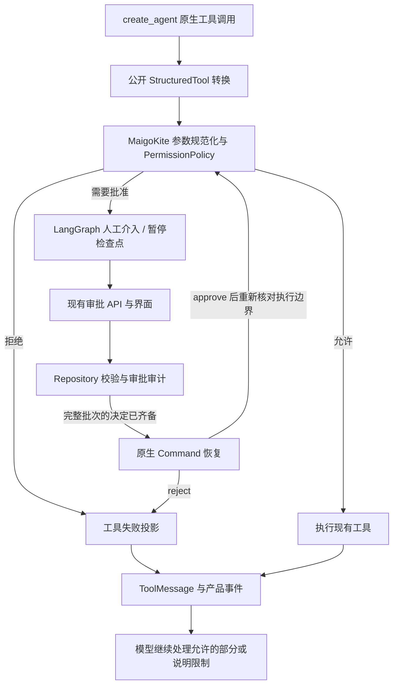

# 智能体运行时设计

> 本文说明聊天执行、工具编排、审批、上下文和运行资源如何协作。
> 以下描述当前实现；已测试的范围与已知问题见 [交付路线与状态](../project/Roadmap.md)。

## 1. 执行入口与迁移范围

生产执行只有一条路径：

```text
FastAPI REST/WS → AgentCore 产品组合根（同一 Python 进程）
→ LangGraphRuntime → LangChain create_agent / LangGraph
→ 原生工具或 MCP → PermissionPolicy / HITL → 产品事件与最终回复
```

普通聊天、显式 `/tool`、批准/回答续接、停止和受限文件任务恢复均走该路径。旧 Loop、
ExecutionEngine、TaskManager、IChatProvider/ChatAdapter 和执行后端开关已删除，不支持回退。
2026-10-10 按用户要求先完成源码切换，随后获准补做前四批定向后端验收；实际范围与结果见
[交付路线与状态](../project/Roadmap.md)，不外推为全量发布验收。

MaigoKite 只维护产品接入部分。模型协议、工具调度、检查点、暂停恢复和上下文摘要由现有 SDK 与运行时承担：

| 模块 | 负责的内容 | 不负责的内容 |
| --- | --- | --- |
| `runtime/langgraph_runtime.py` | 创建与缓存 graph、运行准入、HITL 批次匹配、`Command(resume=...)`、根任务及 checkpoint 生命周期 | 第二套 Agent Loop 或续接状态机 |
| `runtime/product_tools.py` | 参数规范化、调用拦截、执行前权限重查、审批记录匹配及审计/事件投影 | 自定义权限规则、活跃任务或检查点存储 |
| `runtime/projection.py` | 每轮流式文本、公开思考、工具结果的界面映射与事件去重 | 执行状态和恢复；终态标志只表示 UI 终态已投递 |
| `runtime/prompt_safety.py` | 主模型调用前的审查，复用 SafetyReviewer、设置/凭证回调及原生 `interrupt` | 独立审批状态机或运行资源生命周期 |
| `runtime/run_context.py` | `RuntimeRunRequest`、`RunContext`、`ChildContext` 等请求与临时上下文 | 依赖容器或运行时所有者 |

`ProductToolMiddleware` 使用 PermissionManager 判断权限，使用 Repository 保存审计，通过明确回调请求 Runtime 中断。图节点名 `_ProductToolMiddleware` 与 middleware 顺序保持稳定，便于恢复已有检查点。ToolRegistry 只提供发现、元数据和权限信息，不提供另一条 invoke 调度路径。

父运行上下文引用同一个 Repository 和单次 `RunProjection`，子上下文从父上下文取得 Repository；上下文不持有整个 Runtime，工具也不关闭借用的资源。请求类型仍从原 Runtime 模块导出，子上下文仍从子 Agent 模块导出。工具权限快照不复制界面展示标志，结构化结果由 Repository 提交。

上下文预算和记忆注入直接使用 Repository/RunProjection。子 Agent 在图装配时取得模型目录、解析函数、只读图工厂和最新执行元数据回调，借用共享模型客户端；它只读、共享父任务预算，由 TaskGroup 和并发信号量管理，不继承父任务的可复用授权。公开文本通过 `models/reasoning.py` 提取，不另建一套解析和显示逻辑。

聊天的 `thinking` 是独立于输出预算的会话设置：保存和开始运行时均按模型能力校验，切换模型默认清空，
空值不发推理参数。原 `response_mode` 仅保留旧客户端兼容字段，不再将 fast/balanced/thorough 映射到
max_tokens。思考配置进入模型/图缓存身份，但不重建 Runtime。原生 SDK 负责 Responses、Anthropic
adaptive/effort 和 Ollama think；元数据客户端由 Core 模型生命周期持有并关闭，不读取第三方私有字段。
能力来源与未接通接口的边界见 [API：会话思考控制](API.md#36-设置模型和凭证引用)，真实 Provider 的验证范围见路线图。

## 2. 状态与资源所有权

| 内容 | 所有者 / 查询来源 | 不承担的职责 |
| --- | --- | --- |
| 执行状态与待审批调用 | LangGraph 检查点 | 不充当业务审计库 |
| 任务、消息、工具调用、审批与安全审计 | MaigoKite Repository | 不驱动第二套运行时状态机 |
| `task_events / messages` | UI / 产品投影 | 不是运行时恢复的输入事实 |
| 根任务、模型提供方客户端、浏览器/MCP 资源 | 核心服务 / 运行时生命周期 | 单次运行实例不关闭其他运行实例的共享客户端 |

恢复执行看检查点，查询界面看产品投影，审批安全看 Repository。当前部分状态和事件仍分步提交；这是持久化一致性债务，不意味着需要完整事件溯源框架。

检查点按任务建立，保留既有审批恢复 ID。同会话存在未完成任务时拒绝新回合，入口用原生 asyncio.Lock 防止并发提交。新回合按以下边界取得历史：

- 上一回合成功结束：继承同会话最近创建、成功且已结束任务的 checkpoint messages，包含摘要、工具调用和结果；不复制调用计数或待执行节点。
- 初次迁移、上一回合属于 legacy 或失败/取消/中断：只导入可见产品历史，不伪造工具结果或自动重放副作用。

后一种是上下文降级，不是任意失败点的无损续接。TaskManager 已移除。

2026-10-10 的后端收敛补充：

- 聊天准入使用 Repository 方法，在一个事务中准入任务、保存用户消息并拒绝同会话未结束任务。可选 `Idempotency-Key` 绑定工作区、会话、主体和请求内容；重发相同键返回原任务，不重新执行。相同文本使用不同键仍是不同请求，不做语义去重。
- `context.history` 区分 checkpoint 延续与产品历史导入。失败/取消/中断后的导入带执行边界说明：副作用可能已发生，应检查实际状态，不意味着回滚或重新授权。
- 内部 `recover` 拒绝已结束任务、存在更新回合或当前仍在执行的会话；没有 checkpoint 就不恢复。未增加自动重试/通用恢复 API。
- 会话产品快照接口在同一 Core Repository 锁内取得消息、任务、待审批、待回答问题与事件水位。它不是 checkpoint，也不覆盖所有活动增量；接口与截断语义见 [API](API.md)。GUI 已接入快照与聊天幂等键；待处理卡片从真实水位恢复，截断时不将省略请求视为已处理。提问经专用回答接口续接，与普通聊天排队分离。正常 HTTP/WS 的历史/快照终态一致与真实 GUI 刷新已通过定向验收，快照并发、截断及投影异常全矩阵仍待覆盖。

`/tool <name> <json-object>` 是产品命令语法，不再选另一套执行器：公开 `awrap_model_call` 将显式请求返回为原生 AIMessage 工具调用，随后仍经过同一 HITL、PermissionPolicy、ToolNode 与事件投影。工具结果通过同一模型节点返回给用户，不调用 LLM 决定或改写命令；这类命令也跳过摘要模型调用。`bash` 仅映射为 `exec_command` 兼容名，不扩大权限。当前仍需可初始化的模型配置以创建既有 agent 图。

原生模型由 `models/native_model.py` 创建，Core 持有缓存与客户端生命周期；示例和历史验证直接引用生产工厂与 Runtime，Spike 兼容包已删除，不再定义自研聊天协议；Core 可直接注入 BaseChatModel（生命周期归调用者）。公开模型拦截能力见 [LangChain middleware](https://reference.langchain.com/python/langchain/agents/middleware/types/AgentMiddleware/wrap_model_call)。没有新增 Provider 协议、执行状态机或 continuation 数据。

### 历史任务交接

已成功的旧会话可按可见消息开启新回合，不读取旧工具续接 JSON。历史待审批任务没有原生
checkpoint 时，“允许”在消费审批版本前拒绝；“驳回”仍会保存单项拒绝，但因无法续接而报告任务失败；
“取消”才关闭整轮及其待审批项。保存拒绝本身不需要模型凭证。历史 interrupted 且无 checkpoint 的任务不能 resume，应检查已有副作用后
发起新回合。不会自动重放、删除数据库或推断旧任务已经完成。备份时同时保留产品库和检查点库。

## 3. 工具与审批



- ToolRegistry 负责发现、产品元数据和权限信息，LangChain/LangGraph 负责调度。工具通过公开转换入口接入，不依赖私有 `_structured` 字段。
- 原生工具结构定义由 Pydantic/LangChain 表达。产品参数检查复用 `jsonschema`，保留现有错误 DTO、参数清理和显式属性默认值处理；引用解析不得联网或读外部文件。
- 权限策略仍使用既有风险等级、规范化参数摘要值、审批版本、作用域、过期时间和审计。提示词、技能或模型声称“已获授权”没有效力。权威规则见 [工具权限](../agent-capabilities/security/tool-permission.md)。
- 2026-10-11 改为确定性的执行边界与人工审批，不增加审核 Agent。旧 `full_access` 保持兼容受限模式；新 `danger_full_access` 才取消工作区沙箱和逐项权限审批。越界文件、命令网络/沙箱升级走同一 HITL；Runtime 在实际执行前把策略结果的 `sandbox_mode / allow_network` 写入该调用的私有上下文，工具参数不能直接决定权限。
- `once / task / session` 使用既有审批记录与有限期窄范围，不新建授权服务。显式 `session_public_web` 额外覆盖同会话内置搜索与公共网页读取，不覆盖 Browser/MCP/命令，也不改变旧回执。策略负责匹配，Runtime 继续通过原 HITL 准入与审计执行。每次工具执行重新查询当前策略和回执；取消、拒绝、审批版本/hash、checkpoint 恢复沿用现有路径，子 Agent 不继承父任务完全访问或授权回执。拒绝后继续及文件审批重启恢复已有历史验收；新增公共网页授权、窄授权撤销/过期和运行中模式切换全矩阵不在该通过范围。
- 子 Agent 读工具各自持有本次准入的权限副本；并行刷新不改变已开始读操作的上下文。同批其他工具进入审批不等于用户取消，已准入的只读子任务可以完成；显式取消仍随父任务传播并等待清理。子任务回传仅使用最终答案，前导 `<think>` 不混入父任务的工具结果或 UI 摘要。
- HITL 保留原始完整调用批次，UI 一次展示一项审批，收齐允许或驳回决定后才恢复。驳回只将对应操作记为 `denied`，不取消任务、不放行或关闭其他审批。原生 `reject` 的 ToolMessage 把拒绝与理由返回模型，模型继续处理允许部分，无法完成时说明限制。拒绝信息要求不得重试或换工具绕过，但没有额外的跨工具语义识别器。批准记录不证明已执行，已发生副作用也不会回滚。
- 新聊天与批准后的审批续接共用 Python API 的凭证同步，Core 重启后先从既有密钥存储补齐内存凭证。消费批准前检查模型可初始化，并等待前一个 interrupt 根任务退出。驳回也等待旧根退出，并尽力恢复模型凭证，但不为拒绝操作启动 MCP；密钥链或模型不可用不能阻止保存拒绝。后续初始化/执行失败发布 `task.failed`，不伪装为取消或成功。凭证不进入 checkpoint/审批。决定与恢复启动间仍存在崩溃窗口，不声称通用 exactly-once。
- 拒绝与停止分开；HITL 和工具边界 interrupt 均按原生 interrupt ID 恢复。显式停止仍取消并等待根任务，不恢复已取消回合。2026-10-15 已补真实 Core 的拒绝写入后读取并完成、模型流取消、文件审批重启及两个崩溃点验收；完整覆盖与限制见 [当前验收状态](../project/Roadmap.md#当前验收状态)。
- 中断任务的显式恢复沿用相同凭证同步：`POST /tasks/:taskID/resume → ResumeTask → AgentCore.resume_task → LangGraphRuntime.recover → checkpoint`。首版只开放文件读写保留历史，校验 owner、任务版本、最新回合、未归档、无活跃根和未完成检查点；不自动重放所有 interrupted 任务。恢复共用原有会话锁、根任务与取消清理，不新增恢复状态机。审批审计仍在 Repository，运行续接只看 LangGraph；接口边界见 [API](API.md)。
- “允许”还须确认 checkpoint 正在原生审批 interrupt 中，且所选审批的工具 ID/名称属于该批调用；没有检查点或仅剩最终状态时不消费审批版本。消费决定前，按当前工作区规范化 checkpoint 参数，与审批保存的 hash 和风险等级核对，不以可变的 tool_calls 参数投影代替授权证据。“拒绝”不增加这些恢复前置条件。
- 执行前再次通过 PermissionPolicy 和已有审批审计校验：需要批准的调用必须找到当前任务/工具调用对应的已消费记录，参数 hash、名称、风险一致才传入 approved；已通过 HITL 不等于无条件授权。直接恢复到 ToolNode 也经过此检查，不新建审批状态机。已有审批的调用即使当前模式放宽仍须匹配原审批。跨任务/工作区或不同工具复用产品 Tool Call ID 明确失败，不覆盖其他调用的投影与审批；尚未实现 Provider 非唯一 ID 的产品命名空间转换。
- 普通产品工具执行体使用每运行实例的 `asyncio.Lock` 串行化；`delegate` 交给 ToolNode 并发派发，以每任务 semaphore 限制同时运行的子 Agent。这不提供文件快照或跨运行实例的文件隔离，也不能终止同步线程。
- 已删除截断调用列表的 `_SerialApprovalMiddleware`。定向验收已覆盖两项文件调用完整批次审批及部分批准后真实 Core 重启；相同名称且相同参数的调用与完整拒绝投影仍需后续覆盖。旧版本已丢失的调用不能补回。
- MCP 工具通过公开转换接入运行时，`isError: true` 沿用 ToolResult.failure 并映射为错误 ToolMessage，保留原始结果与用户提示。stdio 使用官方 SDK 薄桥接；Linux 本地取消/超时后连接复用、关闭和初始化失败清理已定向验收，不代表远端副作用停止。协议与生命周期见 [MCP](../agent-capabilities/mcp/mcp-integration.md)。
- 断连 MCP 不进入当前可执行工具集合，保存的启用偏好不变。连接状态同时核对 SDK 会话所有者和 stdio 返回的 AnyIO 流公开统计：EOF 后所有者可能仍等待关闭，不能仅凭 Task 未结束宣称已连接。没有新增心跳、协议读取或自动重启。连接异常也是可恢复的 ToolMessage，区分未发送与结果未知，不自动重试。可选扩展启动失败不能阻断普通聊天；文件恢复、回答提问与原生工具批准不启动无关 MCP。MCP 批准仍检查目标连接、凭证与确切工具，不消费不可用目标的审批。

工具选择与权限分离：默认十项基础工具，todo_write/sleep 显式启用，bash 仅兼容历史调用而不交给模型。
设置页控制已注册工具可见性，启动配置的停用列表是上限，执行前再检查选择与 PermissionPolicy。
公开转换复用 [LangChain ToolRuntime/StructuredTool](https://docs.langchain.com/oss/python/langchain/tools)，
仅桥接执行上下文和 ToolResult；jsonschema 校验不另建工具协议。ToolMessage 的产物字段（`artifact`）携带
产品结果，UI 事件保留 `error_code / user_hint / action`；凭证仅在执行上下文内传入。
文件查找与内容搜索复用 [ripgrep](https://github.com/BurntSushi/ripgrep)，删除原有 Python 遍历搜索。

工具名称稳定、目录顺序确定；描述说明用途和副作用，不含敏感凭证。MCP 命名空间防冲突。资源范围和风险必须由代码根据规范化参数判断，不能只依赖工具描述。

个人扩展页将期望配置存入现有 `workspace_settings.extensions.config`，保存不改变工具目录或固定前缀。
应用新配置要求 Core 无活动入口、运行中任务和待处理审批/提问。应用期间阻止新运行准入，候选目录与 LangGraph 入口准备成功才切换；不先销毁旧入口或断开全部 MCP。配置及凭证未改变的健康连接复用，显式应用重新发现其工具；新连接准备失败只回收本次新建资源，旧连接与原配置保持不变。成功切换后才回收被替换资源。新旧实例只在空闲切换期间短暂共存，不接入第二种 Runtime。关闭失败的资源保留所有权，后续应用/关闭再次清理并展示错误。

生效配置单独存入 `extensions.applied_config`，Core 重启优先加载；这只是产品配置，不与 checkpoint 双向同步。恢复原 MCP 连接使用它并复用当前 Skill、健康连接及其工具目录，允许待审批/待回答但仍要求无活动运行，不应用新编辑。缺凭证或启动失败按服务器报告，不撤销其他服务器的恢复结果。复用连接的内存凭证快照从 client 实际启动环境保留，显式应用也与该环境比较，不把并发读到的新密钥误记为已生效。Python API 批准 MCP 工具前可先补密钥链凭证并恢复连接，只检查目标服务及确切工具，目标失败不消费决定；LangGraph HITL 和 Repository hash/version/策略验证不变，不新增续接状态机或副作用恢复能力。

应用任务由 Core 持有到清理结束，调用方断线不提前释放准入锁；shutdown 等待它结束再关闭共享资源。模型 HTTP 客户端、Browser、Repository 与订阅不更换。导入与磁盘 Skill 复用解析器，目录扫描移至标准库工作线程并加协作式预算，详见 [技能扫描边界](../agent-capabilities/skills/skill-lifecycle.md#3-安全与资源)。更新目录会自然改变下一次模型请求的工具/Skill 前缀，不承诺沿用此前 KV cache；不实现插件生命周期或自动热更新。配置保存/应用、失败回退、Skill 读取和无密钥 Core 重启已有真实进程验收；并发/凭证/扫描故障分支见 [当前验收状态](../project/Roadmap.md#当前验收状态)。

2026-10-13 补漏：显式应用仍要求所有启用 MCP 准备成功；恢复连接允许部分成功，健康连接不再因其他服务失败而被断开。新聊天允许部分恢复；文件任务恢复、回答提问和原生工具批准跳过 MCP 准备，不启动或等待无关服务。checkpoint 与后续工具准入校验保留；MCP 批准要求目标可用，拒绝审批不受 MCP 准备步骤影响。不消费未准备好的 MCP 审批、不暗中应用待生效编辑。

### 浏览器与活跃命令进程

- 取消时的 Chromium 清理异常不会转换为普通工具失败后继续运行：保留 `CancelledError` 语义，并通过已有 `tool.failed` 投影 `TOOL_CLEANUP_PENDING` 安全提示。关闭等待最多 10 秒；页面在发起关闭前退出可调用目录，只有公开 `close` 事件确认后才释放 context/profile。重试 `close()` 的无操作返回不当作关闭确认。未确认资源保留到周期回收或 Core 关闭，不能声称远端动作已经停止，也不能自动重试原操作；Core 重启不会重放页面动作。
- Browser 使用官方 Playwright：默认临时上下文；`open(profile="名称", visible=true)` 经审批打开独立登录窗口，用户在窗口中登录，不要求在对话中交密码。具名配置复用 `launch_persistent_context`，目录在 `~/.maigokite/browser-profiles`，按工作区和名称隔离，POSIX 目录权限 0700。它不是密钥链，也不导入日常 Chrome 配置；同一配置只允许一个活动会话。`close` 关闭窗口但保留登录态；当前没有配置目录删除 GUI。
- Core 的既有配置支持 `browser.max_sessions`（默认 4，1–16）与 `browser.idle_timeout_seconds`（默认 1800，60–86400）。启动中的会话也占用名额，超限明确拒绝；每分钟检查无工具操作的空闲会话，持锁/启动中的页面不回收，具名登录数据不删除。同一页面使用标准 asyncio 锁串行操作；排队取消不关闭页面，持锁操作取消或整体 90 秒超时才关闭自己的 context。关闭失败保留资源所有权供后续回收/Core 关闭处理。下载最终路径校验不意外丢失显式完全访问边界。这些是 Playwright 资源管理，不是新 Browser 协议。真实 Chromium 的 profile Cookie、上传/下载/不覆盖/截图和持锁取消已通过；超时/关闭失败、容量/空闲回收全矩阵和真实账号不在该通过范围。
- 活动 session_id 绑定工作区、会话和实际根路径，其他会话不能借 ID 操作。Core 重启后 session_id 失效，需重新 open 同一 profile；浏览器审批仍按临时运行状态处理，不自动重放下载/上传或旧页面点击。
- 页面操作除 Python 超时外，也捕获 Playwright 独立的 TimeoutError；持锁调用先关闭自己的 context，再返回 `BROWSER_ACTION_TIMEOUT`。关闭未确认仍保留原清理待确认路径，排队取消不关闭他人的页面。下载的 cancel/delete 清理另限时 10 秒；超时或关闭页面不能证明网站侧操作未发生，不自动重试。
- `upload(selector,path,url)` 使用 `set_input_files`；`download(selector,path,url)` 使用 `expect_download/save_as`，下载到明确的新文件名，不覆盖既有文件。url 必须取自当前快照；批准后页面 URL 改变则拒绝执行，重新检查与审批。上传/下载均经过审批和工作区/路径白名单约束，浏览器配置目录不可作为传输路径。单文件接收上限 50 MiB、下载操作超时 60 秒；下载大小在完成暂存后检查，不是下载期间的磁盘配额保证。关闭上下文负责回收 Playwright 临时下载。
- 公共 HTTP(S) 导航/资源校验继续保留，禁用 Service Worker 绕过请求路由；这不是完整网络沙箱。可见登录需要桌面显示环境；第三方网站验证码、浏览器限制及断电时登录持久性需要真实网站验收。
- 命令进程继续由 SandboxExecutor 持有，GUI 查询实时尾部、停止指定进程，并等待退出确认。`exec_command(interactive=true)` 必须审批，才创建标准输入管道；GUI 可发送一行输入或 EOF，4096 字节/次。输入不写对话或审计正文，进程可能自行回显。网络失败不自动重发输入。仍有 1–120 秒超时，不是 PTY、后台任务或任务脱离；停止进程只返回工具结果，停止任务才取消整轮。

使用 Playwright 的 [持久上下文](https://playwright.dev/python/docs/api/class-browsertype#browser-type-launch-persistent-context)、[下载](https://playwright.dev/python/docs/downloads) 和 [上传](https://playwright.dev/python/docs/input#upload-files) 接口。真实 Chromium 的文件传输、截图、profile Cookie 与取消清理已通过指定场景测试；超时、关闭失败、回收和跨平台等剩余问题见 [路线图](../project/Roadmap.md#当前验收状态)。

## 4. 用户可见事件

前端只接收 MaigoKite DTO，不接收 LangGraph 类型。事件字段、名称与重放约定唯一来源为 [API 设计](API.md)。

- `message.*` 承载用户可见回答；模型提供方单独返回的公开过程字段或可识别的过程文本进入活动区，不暴露隐藏思维链。
- 对提供方输出在消息开头的 `<think>…</think>` 使用同一套流式/完整文本投影：支持标签跨分片，过程进入 `reasoning.*`，不进入回答事件或产品消息正文；未闭合块仍按过程处理。正文开始后的标签及工具原文不做全局替换，LangGraph checkpoint 的原始模型消息不改写。这是输出兼容处理，不是敏感信息检测。
- 工具参数、结果与错误进入结构化 `tool.*`，默认不混入回答或输入框。
- 审批事件使用现有 `approval.*`，任务终态使用现有协议（成功当前为 `task.succeeded`），不为新运行时重命名。
- 摘要模型输出不投影到用户消息；ToolResult、网页和技能正文是不可信上下文，不能改变权限。
- 聊天/审批/提问/恢复直接调用 Core，HTTP 接纳后执行独立于连接。WebSocket 有界订阅持久事件，发送超时或溢出触发断开与历史补拉，不伪造 task.failed/task.cancelled。
- WebSocket 断线不取消任务。聊天和审批流均透传持久化 event_id/sequence；Python API 在不让出事件循环的注册区间先排入无产品序号的 `stream.ready`，前端收到确认后才补拉连续分页，期间缓冲实时事件，补拉失败重连而不越过缺口。快照水位不推进活动历史游标。后端注册顺序、真实身份及 1006 条历史分页已定向验收；这不是跨 DB/WS 的原子事务，也不代表 GUI E2E 已运行。
- 前端沿用既有 25 秒事件补拉：对仍标为执行中的任务再读取产品快照，弥补终态记录已提交但事件未发布的窗口；不凭连接在线或空历史页推断任务状态，不用快照推进事件游标，也不因对账自动发送队列。正在安装的快照复用同一请求，避免快照完成触发补拉后递归对账。能力查询暂时失败时保留最后确认的能力，不清空现有控件。
- 前端快照安装期间由 EventSocket 保留未确认事件，投影返回 deferred 时不记录身份、不推进游标，安装结束重新补拉。`run.apply` 对单回合暂存修改，失败回滚；成功后才提交去重身份和状态水位。只将渲染通知合并到动画帧，消息投影不再延后到已确认之后。投影失败明确提示同步异常并重连，不伪造任务终态；坏 JSON 帧也触发重连。不能仅凭源码修复宣称“卡在思考”已验收收尾。

## 5. 取消与客户端生命周期

每个运行实例只持有根 `asyncio.Task`：

```text
取消请求
→ root_task.cancel()
→ 等待模型 / 工具 / 执行图事件流结束并清理资源
→ 确认运行实例结束
→ 持久化并发布 task.cancelled
```

Core 关闭时先停止接收新请求，取消并等待仍在准备或运行的入口任务和根任务，再关闭 MCP、浏览器、模型提供方客户端和 Repository。已准入但根任务尚未建立时发生失败或取消，也要更新产品状态。

单个运行取消不关闭共享 HTTP 客户端。客户端由 Core 按工作区/配置项持有，轮换后旧实例保留至可安全关闭，执行图缓存键随模型实例更新。摘要只通过公开模型副本改变回调和请求参数，仍共享 Core 所有的客户端。

Core 多个关闭调用者共享一个受 shield 保护的关闭任务，调用者取消不会遗弃清理。所有根任务排空后，某个资源关闭失败仍尝试关闭其余资源，最后汇总错误；初始化失败同样进入这条清理路径。Chromium 断连后先停止旧 Playwright driver，再创建新实例。默认 checkpoint 路径从实际 Repository 的路径推导，显式配置优先，不因注入临时产品库而写入默认用户数据库。

Anthropic 当前锁定集成在 token callback 处取消时可遗留 HTTP 响应流。`models/anthropic_lifecycle.py` 仅以标准库 `ContextVar / AsyncExitStack` 给本次模型调用拥有的响应登记关闭动作；共享客户端仍由官方 SDK 缓存持有，不在取消时销毁。复用全部官方请求、解析和重试逻辑，唯一临时私有接缝为 `_acreate`；上游修复调用退出时的确定性关闭、同一回归通过后删除该薄适配，不扩展为 Provider 框架。

Ollama/OpenAI-compatible 不借用云端环境密钥。OpenAI/compatible、Ollama 生成请求仅对 loopback 自动绕过环境代理，私网和公网遵循 HTTPX 代理配置；直连仍读取环境 CA。客户端属于 Core，连接验证的临时客户端在调用后关闭。Provider integration 的私有字段/响应转换补丁按 `pyproject.toml` 固定版本维护，升级时同步审阅签名与流关闭语义。

根任务使用 `aclosing` 持有 LangGraph 事件流，事件投影失败或取消时也会显式结束流；之后退出子任务作用域，再发布终态。关闭不再遍历历史 thread 读取 checkpoint：读取不是 flush，持久化依赖 `durability="sync"`、Saver 写入提交和运行清理顺序。本批为静态修改，未新增运行验收结论。

任务/工具异常进入 ToolMessage、Repository 或事件前使用同一安全诊断函数；聊天、交互恢复及模型连接验证 RPC 的异常出口同样使用该函数。仅显式定义的产品错误保留原文，未知异常不公开请求正文、URL 或底层异常字符串。工具成功内容及 MCP 显式返回的数据仍是工具证据，不宣称所有内容都经过敏感信息检测。工具结果只经一个投影入口处理；工具名称读取 Repository，暂停状态读取原生 checkpoint，不另存整份工具调用表或暂停标志。

文件读取检测到二进制内容时使用 `UserFacingError` 返回“不支持读取二进制文件”的具体提示，不包含本地路径；其余未知 `ValueError` 继续脱敏，不能为了提示详细而统一回显原始异常。上述输出/风险修补仅完成代码与静态审阅，未新增运行验收结论。

基础输出预算来自模型配置的 max_tokens，不再被 fast/balanced/thorough 二次截断；已知窗口下的预留与保护见第 6 节。
思考强度使用独立的会话 thinking 和原生 SDK 参数，模型缓存区分实际选择；服务默认不发送覆盖值。
它不代表推理速率、窗口大小或保证的 token 数量，不在 Runtime 写 Provider 协议。

限制：`file_read` 在最多 8 KiB 的读取片段之间协作取消，但单次文件系统调用仍不可抢占；其他同步线程工具无法立即停止。第三方 MCP 传输方式和同步线程取消仍有边界。不得在任务实际仍执行时先宣称停止，不为此建立自研线程杀死机制或取消树。

根任务的取消边界：

- 进入清理用的 try/finally 后，先通过原生 `asyncio.Event` 启动屏障让出执行，再开始准备和执行。RunHandle 等待此边界后才取消。
- 重复停止不重复注入取消；等待使用 shield，避免调用者断线打断清理。停止先校验工作区归属，成功状态已提交时不再发取消终态。
- 执行元数据准备也在根任务保护范围内，审批或回答续接准备失败不会留下无人负责的运行状态。Core 边消费边释放事件，不额外 collect 整个活动历史。

这些是根 Task 的所有权约束，不是新的取消框架。关闭调用者取消及多运行的定向验证范围见 [交付路线与状态](../project/Roadmap.md)，不代表所有并发竞态均已覆盖。

单任务停止始终交给 LangGraphRuntime，不以 checkpoint 是否存在选择执行器；全局 `interrupt()` 同样取消并等待当前根任务，不查询旧 TaskManager。两种停止入口均纳入 Core 跟踪，关闭前会取消并等待它们。

任务已入库但根句柄尚未注册时，停止操作通过会话准入锁等待启动或恢复步骤结束，再检查状态；已有活跃根任务则直接取消。根句柄结束不代表等待审批的任务已取消，仍须更新产品状态并关闭审批。

批量停止只取消尚未结束的根任务，等它们全部清理后再报告错误。已结束但尚待释放回调的句柄不重复抛出旧执行异常阻止关闭。不新增取消 token tree、执行归属数据库或检查点实现。单任务取消、双运行全局停止和关闭顺序已有定向回归，范围见 [交付路线与状态](../project/Roadmap.md)，不代表所有并发竞态均已覆盖。

失败/取消回合的执行边界说明作为系统消息保留在 checkpoint 中，提醒先检查实际状态，不能把重试当作回滚或新的授权。模型调用前，`ContextBudgetMiddleware` 使用 LangChain 公开的消息合并能力，将固定指令、Todo 指令与历史系统消息投影为**唯一的首条 system**；只移动系统消息，不合并用户/助手/工具消息，也不改写 checkpoint。此处理同样覆盖旧 checkpoint、历史导入和压缩后的调用，避免 LM Studio 等严格模板拒绝第二条 system。输入计数及 Anthropic 缓存标记在合并后处理，内容块保持原结构。当前仅做源码与静态检查，不代表 LM Studio 或 Anthropic Live 验收。

## 6. 提示词、上下文与缓存

### 当前输入

固定指令与按名称排序的本地技能目录，结合持久聊天历史、完整工具回合和实际工具结构定义。技能正文通过 `skill read` 按需加载，不每轮重建系统提示词。

手工记忆的请求投影已接入上下文 middleware：文件夹与对话开关同时开启时，每次主模型调用重新读取当前目录的条目，在预算内附带到本次请求副本，不写入消息或 checkpoint。双开关、遗忘和 checkpoint 分离已通过真实 Core 定向验收；自动记忆提取、知识库和向量嵌入检索未接入。

`python/agent/prompts/` 的遗留模板/解析器未接入当前聊天协议。记忆选择、续接与关闭的边界见 [记忆](../agent-capabilities/memory/memory-system.md)，长期记忆与上下文压缩各有独立职责。

### 输入预算与摘要

- 容量来源与回退顺序由 [模型接入](../agent-capabilities/models/model-routing.md#21-当前接入路由的窗口容量) 定义，不按模型名推断部署窗口。`context.max_tokens` 默认 32000，仅用于容量未知时的内部预算保护，不再限制所有已知窗口，也不作为窗口值返回 UI。
- LM Studio 兼容模型复用 Core 所有的 HTTP 客户端，只读查询同一服务的 `/api/v1/models`，按精确模型 key/实例 ID 读取 `loaded_instances[].config.context_length`。无法确定实例、未加载、不支持元数据或鉴权失败时保留原因，不用 `max_context_length` 或同名云模型资料冒充实际加载容量。查询保留反向代理路径，不跟随重定向，不自动加载模型；总超时 3 秒、响应上限 2 MiB，取消只关闭本次响应。
- 容量已知时，`B = max(1, 窗口 - 输出预留 - 估算余量)`；适用目录另有输入上限时再取较小值。余量为 `min(1024, max(128, 窗口 × 5%))`，不是已用 token。输出预留以配置上限为基础，受已知窗口四分之一的策略限制，并保留 SDK 要求的最小输出空间；它不更改保存的配置。摘要与主回复共享容量观测，但分别扣除自身输出预留；子 Agent 独立取得其模型容量。所有本地计数仍是估算。
- 本地加载容量在模型步骤中刷新；远端容量或不可用元数据的结果可在同一次 run 内复用，下一任务/恢复的新 run 重新查询。恢复不依赖旧进程缓存，也不因探测失败循环发送无效请求。
- `context.updated` 在压缩前和正式调用前发布，即使提前拒绝也提供窗口、来源、观测时间、输入预算、输出预留与压缩阈值。显式 `exceed_context_size_error` 回执中的 `n_ctx / n_prompt_tokens` 会覆盖本次观测并以 `measurement=provider` 发布，不作为计费回执，不重新执行工具。此回执不持久化为模型配置，下一步骤仍读取服务端，避免把旧实例容量长期缓存。未知容量仍使用产品预算进行保护，但明确不能据此保证满足服务端窗口。
- 摘要复用原生 `SummarizationMiddleware`。完整输入（历史、固定指令、启用工具和原生 Todo 提示/结构定义）约达到输入预算 `B` 的 80% 时才尝试压缩，不每轮重写历史。
- 补充输入可能在 `before_model` 压缩之后进入消息列表，因此模型请求包装层按实际系统指令、工具定义及消息再次检查阈值；有可压缩历史时复用同一原生摘要路径，不能只因最终请求本地超限而直接拒绝。尚未消费的补充输入与当前回合一并原样保留。包装层的替换通过现有 `ExtendedModelResponse/Command` 随成功回复提交；失败或取消不覆盖旧 checkpoint，不新增续接或摘要引擎。
- 摘要使用共享模型的请求级副本，公开 `disable_streaming` 开关及集成的 `streaming` 字段关闭内部摘要流；`TAG_NOSTREAM` 仅作图事件隔离，不把它当作 SDK 的非流式开关。主回复仍保持流式，HTTP 客户端所有权不变。摘要有独立调用完成事件；取消发出 `context.compaction.skipped(reason=cancelled)` 后再交由根任务结束，避免 UI 遗留“压缩中”。
- 摘要本体软目标为 `min(10% × B, 6000)`，保护上限为 `min(15% × B, 8000)`，至少 1 token。比例基于上述有效输入预算而非压缩后总占比；短历史不凑字数，不要求压缩后填满某一比例。摘要触发、摘要上限与调用前拒绝使用同一预算，模型本身更小的输出限制仍然生效。
- 近期保留量基线为扣除固定开销后预算的 25%，最多 8000 token；当前用户回合与工具配对需要更多时保留更多。原生中间件决定安全切分；不自建历史剪裁/摘要引擎。当前回合本身过大仍可能报错。
- 薄保护保留系统指令与最近用户请求，检查摘要请求本身的预算、错误/空摘要、Provider 截断标记、摘要上限、压缩收益和压缩后的整体预算。失败不提交替换，不反复重试；取消随根任务传播。所有本地 token 计数仍是近似值，不保证 Provider 精确窗口。
- 压缩过程发出 `context.compaction.started / failed / skipped`，成功沿用 `context.compacted`；无可压缩历史时不伪造成功。前端已接压缩状态、容量来源和失败反馈，字段见 [API](API.md#38-gui-交互与执行检查接口2026-10-10)。这些新增接线尚未完成测试或真实服务验收；没有手动压缩 API，也不提供对应按钮。
- 摘要是有损信息。超大输入或工具结果、初始历史已超模型提供方容量时可能仍失败，不构建无限重试或第二套分块摘要引擎。

### 缓存和调用限制

- 工具目录与系统指令前缀保持稳定；未触发压缩时不改写历史，不放入任务 ID、时钟或实时状态。
- Anthropic 使用官方 `AnthropicPromptCachingMiddleware`，当前默认 TTL 5 分钟；其他模型提供方不接收 Anthropic 参数。
- 主模型、摘要与子 Agent 均记录 Provider/SDK 返回的 `model.usage`，通过 `purpose: response | summary | subagent` 分开。合并 SDK 标准用量与 Provider 原始字段，兼容 OpenAI 缓存详情、Anthropic cache read/create、DeepSeek hit/miss；未返回的缓存字段保持缺失，不估算成命中。任务 inspection 汇总已报告的用量与模型调用次数。
- `model.call.started/failed` 和 `context.compacted` 用于识别无用量回执、额外摘要成本与压缩次数；SDK 内部重试、取消后服务端计费和丢失回执不保证可观测，汇总不是完整账单。缓存/推理是输入/输出的子集，不重复加到总 token。
- 不按模型名称硬编码缓存率、价格或容量；服务端缓存不等于本地回答缓存。
- KV/prompt 缓存优化复用稳定指令、工具顺序和已有 checkpoint 消息；不主动滚动裁掉历史工具结果、不为凑命中率发送额外请求。压缩是必要时的一次前缀失效，之后复用摘要形成的新前缀。Provider TTL/路由/本地推理服务策略仍由服务端决定，本批没有命中率实测结论。
- 原生 `ModelCallLimitMiddleware` 保留单图上限；新任务同时快照 `tools.max_iterations`（默认 8）为产品 `model_call_limit`，Repository 原子预占 `model_calls_used`，主模型、摘要、子 Agent 共享预算，失败与取消不退还。为父任务最终汇总保留一次调用；子 Agent 单图最多 4 次且不突破共享限额。旧任务没有预算快照时保留原生限制。这里限制的是 SDK 调用次数，不是 Provider 内部重试、精确 token 或账单上限。
- 自动路由/降级设置尚未接线；本次随旧 Provider 删除未接线的私有降级代码，不在新 Runtime 重建。

### 工具输出先减量

- `file_read` 默认 16000 字节、单次有效上限 64000 字节；返回 `offset / next_offset / truncated / file_size_bytes`。使用返回的 UTF-8 字节游标继续读取，避免切断字符；非 UTF-8 不支持游标续读。分页不是文件快照，外部修改后应重新读取。
- `grep` 默认最多 30 条，单段上下文最多 2000 字符、合计约 16000 字符；保留文件/行号和截断标记，继续用更窄范围搜索。
- `exec_command` 默认 stdout/stderr 各 8000 字节预览，允许每流最多 32000；完整输出落在当前工作区 `.maigokite/outputs/command_*.log`，返回路径后可分页读取。日志不会自动清理，当前没有磁盘配额/保留期，用户需按实际需要管理；目录与文件路径仍受工作区边界约束。
- ToolMessage 沿用既有 `data` 与 `raw` 去重，完整执行证据留在产品 artifact，不重新实现 Tool 调度。工具分页限额用于减少输入，不保证总 token 数，也不增强 OS sandbox。

复用依据：[LangChain 中间件](https://docs.langchain.com/oss/python/langchain/middleware/built-in)、[OpenAI 提示词缓存](https://developers.openai.com/api/docs/guides/prompt-caching)、[Anthropic 提示词缓存](https://platform.claude.com/docs/en/build-with-claude/prompt-caching)。这些链接是既有设计依据，本次文档归并没有重新验证服务端表现。

实际加载容量字段依据：[LM Studio 原生模型列表](https://lmstudio.ai/docs/developer/rest/list)（`loaded_instances[].config.context_length` 与理论 `max_context_length` 分离）；不把 OpenAI-compatible `/v1/models` 的普通模型目录当作已加载实例配置。

## 7. 技能、子任务与工作流边界

当前 `instruction / workflow` 技能只提供可读取的声明流程，不执行包内代码、不扩大权限，也不是可恢复 DAG。编写格式和加载规则仅在 [技能](../agent-capabilities/skills/skill-lifecycle.md) 维护。

后续先选择一个真实个人流程：输入、交付物、审批位置、失败处理可验证后再实现。能用顺序技能完成的，不升级为工作流引擎。

### 结构化任务结果（源码接入，未运行验收）

- `SendMessage.output_schema → RuntimeRunRequest → create_agent(response_format=ToolStrategy(...))`，每任务单独编译图，沿用共享模型与客户端，不为每种用户 Schema 建永久图缓存。普通聊天、子 Agent 和摘要调用不默认开启该模式。
- 复用 [LangChain 结构化输出](https://docs.langchain.com/oss/python/langchain/structured-output)，不实现 JSON 文本提取、Provider 协议或新的 Agent Loop。当前依赖对原始 JSON Schema 的结果只作解析，产品边界补用现有 `jsonschema` 实现完整约束校验；不使用 SDK 私有字段。Schema 开销计入现有上下文预算和压缩触发计算。
- 官方内部结果工具使用保留名称，不经产品 ToolRegistry/PermissionPolicy，也不产生虚假审批或工具执行事件；其他真实工具仍逐次检查权限。结果不能与尚未执行的工具混在同次模型输出里提交，避免消费工具执行前的结论；错误直接使任务失败，不扩建纠错/重试引擎。
- 最终提交只读取完成 checkpoint 的 `structured_response`，校验后由 Repository 原子保存结果、可见助手消息和任务成功。调用期间的流式文字不是工作流数据；下游读取 [任务结果接口](API.md#结构化任务结果)，不解析消息或事件拼接结果。
- 准入冻结 Schema，审批/提问恢复使用同一契约；恢复最终 checkpoint 与产品投影之间的崩溃窗口时不调用图、不重放工具，只校验并补存结果。仍需继续执行的中断任务沿用文件读写恢复门限；新字段不扩大 MCP/浏览器重放能力。
- 本批仅提供任务输入/结果契约，不增加工作流调度器、步骤自动串联、前端模式开关或新状态机。沿用现有调用预算、HITL、根 Task 取消和客户端所有权；真实 Provider 支持度及恢复/取消行为未在本批运行验收。

### 会话级子 Agent（指定模型与独立对话已定向验收）

复用 [LangChain subagent-as-tool](https://docs.langchain.com/oss/python/langchain/multi-agent/subagents) 与 [LangGraph per-invocation 子图](https://docs.langchain.com/oss/python/langgraph/use-subgraphs)：`delegate → create_agent.ainvoke`，不另建 SubAgentManager、子任务状态机或 continuation。

- 聊天框可保存 `max_subagent_calls`（每用户回合累计派发 0–32，默认 0 关闭）与 `max_concurrent_subagents`（并行 1–8，默认 1，启用时不大于累计上限）。这是上限，不是必须派发的数量；模型仍自行决定是否值得委派。
- 会话设置在新任务准入事务中快照。运行中修改只影响新回合，不重置当前额度；审批续接沿用任务快照。首版工具还有启动配置和工作区工具开关的限制。
- `subagent_model_ids` 保存允许显式选择的现有模型配置 ID，与额度一起快照到任务；空列表只允许跟随父模型，不代表全部可用。用户在聊天中指定名称，主模型通过 `list_subagent_models` 查询精确 ID，调用 `delegate(task, model_id?, label?)`；名称歧义或配置缺失时应询问，不猜测 ID、不静默降级。自然语言是否被模型正确遵循仍需要真实模型验收。
- 模型清单只含 ID、显示名称、协议提供方及服务端模型名，不带 URL/密钥。清单按需作为工具结果追加，工具 schema 不随目录变化。显式模型在派发时由现有 ModelRuntime/Model Factory 解析，复用 Core 所有的客户端和原生子图；目标使用既有 balanced 输出预算，不复制另一提供方的推理参数。已开始的子任务不会热切换模型。授权快照固定的是配置 ID，不是模型配置内容的版本锁。
- Python API 在开始前先同步父模型，再同步允许子模型的凭证；审批、提问与恢复入口按任务已保存的清单同步，避免 Core 重启后只恢复父模型凭证。已删除的可选子模型不阻止主任务准入，清单查询不再列出它；真正派发到缺失配置时仍失败，不自动换模型。父模型缺失仍是准入错误。凭证仅进入 Core 模型服务，不写 checkpoint、任务记录或子工具上下文。
- `tool_calls.subagent_admitted` 是不可退还的产品准入收据，同一调用 ID 重放不重复占位，新的派发必须用新 ID；失败、超时和取消不退额度。没有新增执行状态库；子图状态由父图 checkpointer 管理。
- 子 Agent 默认使用本回合父模型，也可使用上述允许模型；只收到委派说明，不复制父会话历史。只开放启用的 `file_read / glob / grep`，每次执行仍经过原 PermissionPolicy 和权限撤销检查；子工具不继承写权限、凭证、进程句柄或批准，不暴露 MCP、shell、提问、浏览器、Skill 执行和递归委派。
- ToolNode 调度、`asyncio.Semaphore` 限并行、根任务 `TaskGroup` 持有排队和运行的子任务；停止/关闭等待清理再发父任务终态。单个子任务进入执行后的超时为 120 秒，不含排队。底层同步系统调用仍不能抢占。
- 每个子 Agent 再以原生 TaskGroup 持有自己的读工具，失败/超时须先等待这些读操作清理，不能让它们留到父任务的下一轮。出队和每次模型请求前同样检查父任务状态、当前工具开关、权限模式及工作区；权限撤销不只等到下一次文件读取才发现。不新增取消树或私有调度器。
- 已准入子任务在兄弟工具进入 `waiting_approval` 时可以继续消耗原共享预算完成只读调查；父模型不能据此继续请求，取消/失败等终态仍拒绝。TaskGroup 清理后包装的单个产品错误保留安全的预算/权限提示，多个异常或第三方异常不公开原文。
- 子图继承父检查点的每次调用命名空间，使用独立消息上下文并返回带文件/行号引用的摘要。结果上限复用父任务有效输入预算与 token 估算：扣除系统/工具开销和当前 checkpoint 消息后，按本批工具调用数均分，并受既有摘要目标上限约束。审批恢复若直接进入工具节点，由预算中间件重新计算配置开销，不依赖旧进程的估算值。子模型支持时通过本次调用的模型副本限制输出，不覆盖其思考最低预算；回传时仅保留预算内的完整段落及闭合代码块，计入截断提示。服务端截断的最后一段不作为完整结论。计数是估算，不保证 Provider 精确 token；共享工作区文件仍不是快照。
- `subagent.*` 进入同一任务的活动区，started/progress/completed 记录实际模型 ID、名称、提供方和任务标签，queued 只记录请求的模型 ID；子 Agent 流式正文不进入主回复，`model.usage` 以 `purpose=subagent` 计入总消耗，不覆盖主上下文指示器。子图上下文仍使用既有输入预算，不保证总 token/费用上限。
- 本次不扩大 `ResumeTask` 的文件读写白名单：含 delegate 的中断任务暂不能从公共恢复接口重跑。检查点存在不等于跨进程子 Agent 恢复已经验收。

此前定向测试发现 `delegate` 的 `ToolRuntime` 注入参数被 StructuredTool 的参数转换丢弃。2026-10-14 修复在转换前用标准库 `get_type_hints` 解析两个工具回调的延迟注解，保留显式 Pydantic 参数校验与 SDK 注入，不将 runtime 暴露给模型。2026-10-15 已补真实 Core 的指定子模型、实际文件工具回合与主/子回复隔离，以及真实 Web 的独立页签/刷新和默认额度保存；自然语言选模、取消/撤销/共享预算边界与子图跨进程恢复仍需各自验收。

参考 [DSH 模型选择与独立/继承上下文委派](https://github.com/deepseek-ai/deepseek-harness/blob/master/packages/subagent/tool-subagent/README.md) 的交互边界，不复制其 Cordis/插件/子生命周期框架。当前仍是等待子图结果的工具调用，不是后台启动并返回 ID；后台委派、后续发消息、子 Agent Fork、worktree 和写入型子 Agent 均未交付。

### 独立聊天分岔（API 主路径已定向验收）

会话 API 创建新的产品会话并复制某条助手回复之前的可见 user/assistant 历史。源会话必须空闲，复制上限 500 条/2 MiB，超限拒绝；请求幂等与复制在同一产品事务内完成。分岔不调用模型，也不复制任务、审批、工具结果、事件、队列或 checkpoint；普通下一轮仍进入唯一 LangGraph Runtime，首次从现有产品历史导入入口读取消息并追加“文件共享、未回滚、审批不继承”的边界说明。首次模型调用后仍由原生 checkpoint 维护执行状态，不新增 Runtime continuation。完全访问/旧自动模式降为工作区权限，须用户重新选择才提升。

这是对话上下文分岔，不是执行 time travel、工具重放、Git worktree 或文件快照。GUI 在已保存助手回复下方的「⋯ → 从此处分叉新对话」传入所选消息 ID，侧栏会话管理不再承载分叉入口。API 已验收可见消息独立 ID、不复制任务、记忆默认关闭；图片增量另验了附件引用复制。旧库迁移、幂等并发及 GUI 分叉点击仍未覆盖，见 [数据库](Database.md)、[API](API.md#32-会话与消息) 与 [当前验收状态](../project/Roadmap.md#当前验收状态)。

持久确定性流程先评估现有检查点的组合，不另建工作流平台。缓存预热、复杂插件生命周期、版本化提示词/对照评测与自动重规划均非当前交付；只有实测需求和收益后才考虑。

### 空骨架清理不取消能力需求

2026-10-10 移除 `workflow/engine.py`、`workflow/hitl.py`、`workflow/__init__.py`、`sub_agent_manager.py`、`recovery.py` 五个文件。依据不只是“没有调用”：初始化和执行方法均为 `...`，没有生产或测试消费者，也没有需要保持的已用接口契约；其中预设的编排/HITL/恢复职责应优先由现有 Runtime 承担。源码可从 Git 历史恢复，不删除业务数据或真实执行入口。

| 保留的能力 | 已有实现 / 事实 | 真实缺口与后续归属 |
| --- | --- | --- |
| 人工审批 / HITL | PermissionPolicy、Approval API/Repository、LangGraph HumanInTheLoopMiddleware | 保留风险/参数 hash/version/审计；补齐新路径多审批和重启语义，不恢复第二套 HITLCoordinator |
| 状态恢复 / Recovery | LangGraph checkpoint、resume_approval/recover、Core 中断任务对账 | 恢复与投影一致性、副作用重放和浏览器/MCP 易失状态仍有缺口；复用检查点并按工具明确可恢复边界，不增加通用 rollback/retry 状态机 |
| 个人工作流 | Skill 可读取声明步骤，当前不是持久执行图 | 保留流程复用目标；需要确定性分支/暂停/恢复时组合 LangGraph 图与现有审批，不把空 WorkflowEngine 计作实现 |
| 子 Agent | 单层只读 delegate、指定模型/文件回合、独立对话与刷新已有定向回执 | 权限撤销/共享预算/取消/跨进程边界仍需覆盖；不增加私有调度框架 |

第四批已删除旧主循环、TaskManager、ExecutionEngine、聊天 Provider 包装与旧续接读写代码。现有库的 continuation_json 列与历史数据仅保留兼容，不用于执行。空壳清理和旧链删除不提升 Workflow/SubAgent 的完成度。

## 8. 文件副作用与验证状态

LangGraph 恢复是至少执行一次（at-least-once），不保证工具恰好一次（exactly-once）。`file_write` 在工具内部按实际编码/平台换行后的字节做有界分块比较，不再由 Runtime 按工具名截断执行。相同字节返回 `reconciled: true`、`bytes_written: 0` 和 `size_bytes`，不重复写入；经同一 StructuredTool 转换、审计和 `tool.completed / file.changed` 投影。

核对回执不能证明是哪一次运行写入了文件。恢复时原始 before image 未知，文件事件使用 `before_hash: null / diff_truncated: true / reconciled: true`，不伪造空 Diff。目标现状和哈希仍受既有读取上限限制。编码在打开目标文件之前完成，编码错误不会先截断文件；实际覆盖写入仍非原子写，不能保证写到一半崩溃不留下部分内容。这是相同内容的自然状态核对，不涵盖不同内容、外部修改、并发运行实例或任意工具副作用，也不提供文件系统 TOCTOU 隔离。

审批后尚未执行、写入已发生但 ToolMessage/检查点未提交两类崩溃点均须保留真实测试，不能用投影成功掩盖重放行为。

2026-10-10 的获准定向验收已通过上述两个真实 Core 进程崩溃点，以及单项/部分审批后的重启。进程样例仍调用既有恢复路径，最新收口另验收 Gateway 的公开 ResumeTask 转发及版本/归属/资格拒绝。公开的验收范围与未完成项见 [交付路线与状态](../project/Roadmap.md)。本地模拟 Provider 不算 Live，后端回归不代替 GUI 操作验收。

验证入口见 [测试与验收](../testing/TestPlan.md)。现有重点文件：

| 入口 | 验证对象 |
| --- | --- |
| `test_langgraph_production.py` | 生产桥接、审批、取消、投影与文件结果 |
| `test_langgraph_process_recovery.py` | 真实进程终止/重启、检查点和副作用恢复 |
| `test_context_optimization.py` | 输入预算、配对、摘要失败/取消、技能、用量及凭证轮换 |
| `test_runtime_spike_http.py` | 本地 HTTP/SSE 模型提供方协议；不代替真实服务验收 |

此前上下文优化记录为 Python 100 项通过、4 项跳过，相关 Ruff/mypy 通过；这是历史版本结果。单 Runtime 收口及后续增量的验证范围见 [交付路线与状态](../project/Roadmap.md)，不得与历史数字相加作为全量回归结果。Browser 生命周期的关闭失败注入检查不等于 Playwright 操作 E2E；新增代码也不自动继承历史 GUI、构建或真实模型提供方的验收结论。

## 9. 既有研究依据与采用边界

以下保留此前研究快照，不作为本次文档归并的新调研或验收。

主要参考仍为 Codex、Claude Code、DeepSeek Harness；按用户要求将 **pi** 纳入固定参考范围，重点对照轻量个人智能体的实现。纳入参考不等于引入依赖或重新选择运行时。

| 项目 | 工作流与子智能体 | 上下文与缓存 | 对 MaigoKite 的取舍 |
| --- | --- | --- | --- |
| DeepSeek Harness | 工作流通过 JS 脚本组合子智能体，提供顺序流水线、并行组合；当前实现不支持工作流进程重启续跑。子任务结果追加到父上下文，中间过程不整段回灌 | 压缩保持工具调用与结果配对；压力下可先裁剪工具结果，再摘要。稳定的请求前缀有利于服务端缓存 | 学习边界和故障语义，不移植 Cordis、JS VM 或能力插件体系 |
| Codex | 技能承载可复用流程；子智能体隔离探索、测试等中间内容，父任务收集摘要 | 工具列表顺序、稳定指令和历史前缀影响缓存；公开架构说明中使用 Responses 上下文压缩管理长上下文 | 学习稳定前缀与按需加载，不将 OpenAI 专有压缩接口强加给 Ollama/兼容服务 |
| Claude Code | 技能与隔离子智能体分工；动态工作流支持脚本编排、保存与按已有结果重放，不等于副作用恰好一次（exactly-once） | 清理旧工具输出再压缩。官方工作流文档说明，同前缀子智能体可错峰启动以复用缓存 | 借鉴按任务隔离、结果汇总及缓存观测，不加入预热队列；当前子任务范围见第 7 节，不沿用研究时尚无并行派发的状态 |
| pi | 对照智能体核心的工具调用调度、事件、取消及运行中补充指令/后续消息；区分核心能力、扩展与示例，不把后两者当作内置工作流或子智能体 | 对照上下文压缩、分支摘要、模型输入投影及模型提供方缓存行为 | 研究小核心与按需扩展的边界；优先评估成熟组件，不将 TypeScript 主循环翻译成另一套 Python 运行时 |

DSH 源码快照：`d743267388641bc76f17c45ce8b4c231aed1d32c`。
依据：[工作流](https://github.com/deepseek-ai/deepseek-harness/blob/d743267388641bc76f17c45ce8b4c231aed1d32c/packages/workflow/workflow/README.md)、[子智能体](https://github.com/deepseek-ai/deepseek-harness/blob/d743267388641bc76f17c45ce8b4c231aed1d32c/packages/subagent/subagent/README.md)、[上下文压缩](https://github.com/deepseek-ai/deepseek-harness/blob/d743267388641bc76f17c45ce8b4c231aed1d32c/docs/subsystems/compaction.md)、[DeepSeek 适配层](https://github.com/deepseek-ai/deepseek-harness/blob/d743267388641bc76f17c45ce8b4c231aed1d32c/packages/llm/llm-deepseek/README.md)。

Codex 依据：[智能体主循环官方说明](https://openai.com/index/unrolling-the-codex-agent-loop/)、[技能](https://learn.chatgpt.com/docs/build-skills)、[子智能体](https://learn.chatgpt.com/docs/agent-configuration/subagents)。Claude Code 依据：[运行机制](https://code.claude.com/docs/en/how-claude-code-works)、[技能](https://code.claude.com/docs/en/skills)、[子智能体](https://code.claude.com/docs/en/sub-agents)、[工作流](https://code.claude.com/docs/en/workflows)。Claude Code 结论仅依据公开文档，不声称核验其未公开内部实现。

### pi 的参考范围

2026-10-09 访问原仓库 `badlogic/pi-mono` 时，其地址重定向至 [earendil-works/pi](https://github.com/earendil-works/pi)。本次仅补充参考范围并初读官方文档与主循环入口，不代表完成整个仓库的源码审阅；后续形成具体实现结论时需固定提交版本，避免混用不同版本行为。

- **pi-agent-core**：重点调查工具调用与结果配对、顺序/并发执行、事件顺序、取消完成边界，以及用户运行中补充指令和后续消息的区别。依据：[智能体核心](https://github.com/earendil-works/pi/blob/main/packages/agent/README.md)、[主循环源码](https://github.com/earendil-works/pi/blob/main/packages/agent/src/agent-loop.ts)。
- **pi-ai**：重点调查多模型提供方、OpenAI-compatible 兼容边界、流式工具调用、异常/取消与用量反馈；比较可复用组件和当前模型适配器的维护成本，不自行抄写协议实现。依据：[pi-ai](https://github.com/earendil-works/pi/blob/main/packages/ai/README.md)。
- **pi-coding-agent**：重点调查会话上下文投影、压缩与分支摘要、技能按需加载及扩展边界；只借鉴通用个人智能体能力，不把产品重新收窄为编码助手。依据：[编码智能体](https://github.com/earendil-works/pi/tree/main/packages/coding-agent)、[上下文压缩](https://github.com/earendil-works/pi/blob/main/packages/coding-agent/docs/compaction.md)。
- **采用门槛**：当前核心服务为 Python，pi SDK 为 TypeScript。需比较直接复用/进程适配所带来的部署和生命周期成本与可删除的自研代码，不因它轻量就直接加入第二个执行内核；若替换收益明确，再单独提出迁移决策。本次不修改运行代码、不安装 pi、不运行测试。
