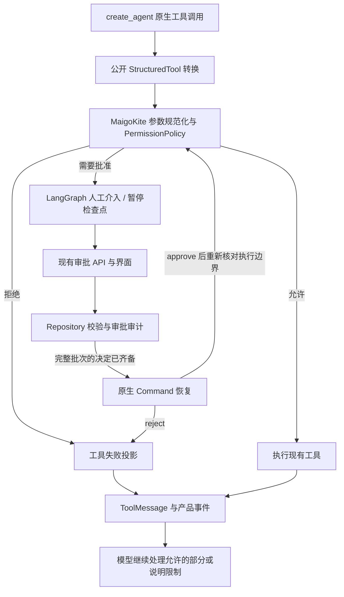

# 智能体运行时设计

> 本文说明聊天执行、工具编排、审批、上下文和运行资源如何协作。已知问题集中列在文末。

## 1. 执行入口

生产执行只有一条路径：

```text
FastAPI REST/WS → AgentCore 产品组合根（同一 Python 进程）
→ LangGraphRuntime → LangChain create_agent / LangGraph
→ 原生工具或 MCP → PermissionPolicy / HITL → 产品事件与最终回复
```

普通聊天、显式 `/tool`、批准/回答续接、停止和受限文件任务恢复均走该路径。旧 Loop、ExecutionEngine、TaskManager、IChatProvider/ChatAdapter 和执行后端开关已删除。

MaigoKite 只维护产品接入部分；模型协议、工具调度、检查点、暂停恢复和上下文摘要由 LangChain / LangGraph 承担：

| 模块 | 职责 |
| --- | --- |
| `runtime/langgraph_runtime.py` | 创建与缓存 graph、运行准入、HITL 批次匹配、`Command(resume=...)`、根任务及 checkpoint 生命周期 |
| `runtime/product_tools.py` | 参数规范化、调用拦截、执行前权限重查、审批记录匹配及审计/事件投影 |
| `runtime/projection.py` | 每轮流式文本、公开思考、工具结果的界面映射与事件去重；终态标志只表示 UI 终态已投递 |
| `runtime/prompt_safety.py` | 主模型调用前的审查，复用 SafetyReviewer、设置/凭证回调及原生 `interrupt` |
| `runtime/run_context.py` | `RuntimeRunRequest`、`RunContext`、`ChildContext` 等请求与临时上下文 |

`ProductToolMiddleware` 使用 PermissionManager 判断权限，使用 Repository 保存审计，通过明确回调请求 Runtime 中断。图节点名 `_ProductToolMiddleware` 与 middleware 顺序保持稳定，便于恢复已有检查点。ToolRegistry 只提供发现、元数据和权限信息，调用调度统一走 LangGraph。

### 上下文与所有权

父运行上下文引用同一个 Repository 和单次 `RunProjection`，子上下文从父上下文取得 Repository；上下文不持有整个 Runtime，工具也不关闭借用的资源。请求类型仍从原 Runtime 模块导出，子上下文仍从子 Agent 模块导出。工具权限快照不复制界面展示标志，结构化结果由 Repository 提交。

上下文预算和记忆注入直接使用 Repository / RunProjection。子 Agent 在图装配时取得模型目录、解析函数、只读图工厂和最新执行元数据回调，借用共享模型客户端；它只读、共享父任务预算，由 TaskGroup 和并发信号量管理，不继承父任务的可复用授权。公开文本通过 `models/reasoning.py` 提取。

聊天的 `thinking` 是独立于输出预算的会话设置：保存和开始运行时均按模型能力校验，切换模型默认清空，空值不发推理参数。原 `response_mode` 仅保留旧客户端兼容字段，fast/balanced/thorough 不再映射到 max_tokens。思考配置进入模型/图缓存身份。原生 SDK 负责 Responses、Anthropic adaptive/effort 和 Ollama think；元数据客户端由 Core 模型生命周期持有并关闭。能力来源见 [API：会话思考控制](API.md#36-设置模型和凭证引用)。

## 2. 状态与资源所有权

| 内容 | 所有者 / 查询来源 |
| --- | --- |
| 执行状态与待审批调用 | LangGraph 检查点 |
| 任务、消息、工具调用、审批与安全审计 | MaigoKite Repository |
| `task_events / messages` | UI / 产品投影 |
| 根任务、模型提供方客户端、浏览器/MCP 资源 | 核心服务 / 运行时生命周期 |

恢复执行看检查点，查询界面看产品投影，审批安全看 Repository。检查点与业务库分开存储、互不同步：检查点只服务执行续接，产品数据以 Repository 为准。当前部分状态和事件仍分步提交，是一笔持久化一致性债务。

检查点按任务建立，保留既有审批恢复 ID。同会话存在未完成任务时拒绝新回合，入口用原生 asyncio.Lock 防止并发提交。新回合按以下规则取得历史：

- 上一回合成功结束：继承同会话最近创建、成功且已结束任务的 checkpoint messages，包含摘要、工具调用和结果；不复制调用计数或待执行节点。
- 初次迁移、上一回合属于 legacy 或失败/取消/中断：只导入可见产品历史。这是上下文降级：副作用可能已经发生，应检查实际状态；重试不回滚已发生的副作用，也不重新授权。

### 准入与幂等

- 聊天准入使用 Repository 方法，在一个事务中准入任务、保存用户消息并拒绝同会话未结束任务。可选 `Idempotency-Key` 绑定工作区、会话、主体和请求内容；重发相同键返回原任务，不重新执行。相同文本使用不同键仍是不同请求，不做语义去重。
- `context.history` 区分 checkpoint 延续与产品历史导入。
- 内部 `recover` 拒绝已结束任务、存在更新回合或当前仍在执行的会话；没有 checkpoint 就不恢复。
- 会话产品快照接口在同一 Core Repository 锁内取得消息、任务、待审批、待回答问题与事件水位。快照用于界面恢复，不是 checkpoint，也不覆盖所有活动增量；GUI 从真实水位恢复待处理卡片，截断时不把省略的请求视为已处理。提问经专用回答接口续接，与普通聊天排队分开。接口与截断语义见 [API](API.md)。

### `/tool` 命令

`/tool <name> <json-object>` 是产品命令语法：公开 `awrap_model_call` 将显式请求返回为原生 AIMessage 工具调用，随后仍经过同一 HITL、PermissionPolicy、ToolNode 与事件投影。工具结果通过同一模型节点返回给用户，不调用 LLM 改写命令，也跳过摘要模型调用。`bash` 仅映射为 `exec_command` 兼容名。创建 agent 图仍需可初始化的模型配置。

### 历史任务交接

已成功的旧会话可按可见消息开启新回合，不读取旧工具续接 JSON。历史待审批任务没有原生 checkpoint 时，“允许”在消费审批版本前拒绝；“驳回”保存单项拒绝，但因无法续接而报告任务失败；“取消”关闭整轮及其待审批项。保存拒绝不需要模型凭证。历史 interrupted 且无 checkpoint 的任务不能 resume，应检查已有副作用后发起新回合。备份时同时保留产品库和检查点库。

原生模型由 `models/native_model.py` 创建，Core 持有缓存与客户端生命周期；Core 可直接注入 BaseChatModel（生命周期归调用者）。公开模型拦截能力见 [LangChain middleware](https://reference.langchain.com/python/langchain/agents/middleware/types/AgentMiddleware/wrap_model_call)。

## 3. 工具与审批



- ToolRegistry 负责发现、产品元数据和权限信息，LangChain/LangGraph 负责调度。工具通过公开转换入口接入，不依赖私有 `_structured` 字段。
- 原生工具结构定义由 Pydantic/LangChain 表达。产品参数检查复用 `jsonschema`，保留现有错误 DTO、参数清理和显式属性默认值处理；引用解析不联网、不读外部文件。
- 权限策略使用既有风险等级、规范化参数摘要值、审批版本、作用域、过期时间和审计。授权只来自 PermissionPolicy 的审批记录，提示词、技能或模型文本中的“已获授权”一律无效。权威规则见 [工具权限](../agent-capabilities/security/tool-permission.md)。
- 执行边界与人工审批是确定性的：旧 `full_access` 是兼容受限模式，`danger_full_access` 才取消工作区沙箱和逐项审批。越界文件、命令网络/沙箱升级走同一 HITL；Runtime 在实际执行前把策略结果的 `sandbox_mode / allow_network` 写入该调用的私有上下文，工具参数不参与权限判定。
- `once / task / session` 复用审批记录与有限期窄范围。显式 `session_public_web` 额外覆盖同会话内置搜索与公共网页读取，不覆盖 Browser/MCP/命令。策略负责匹配，Runtime 通过 HITL 准入与审计执行；每次工具执行重新查询当前策略和回执，子 Agent 不继承父任务的完全访问或授权回执。
- 子 Agent 读工具各自持有本次准入的权限副本；并行刷新不改变已开始读操作的上下文。同批其他工具进入审批时，已准入的只读子任务可以继续；显式取消仍随父任务传播并等待清理。子任务回传仅使用最终答案，前导 `<think>` 不混入父任务的工具结果或 UI 摘要。
- HITL 保留原始完整调用批次，UI 一次展示一项审批，收齐允许或驳回决定后才恢复。驳回只将对应操作记为 `denied`，不取消任务、不放行或关闭其他审批。原生 `reject` 的 ToolMessage 把拒绝与理由返回模型，模型继续处理允许部分，无法完成时说明限制；拒绝信息要求不得重试或换工具绕过。批准记录只表示决定已保存，副作用是否发生以实际执行为准，已发生的副作用不会回滚。
- 新聊天与批准后的审批续接共用 Python API 的凭证同步，Core 重启后先从既有密钥存储补齐内存凭证。消费批准前检查模型可初始化，并等待前一个 interrupt 根任务退出。驳回也等待旧根退出，并尽力恢复模型凭证，但不为拒绝操作启动 MCP；密钥链或模型不可用不阻止保存拒绝。后续初始化/执行失败发布 `task.failed`。凭证不进入 checkpoint/审批。决定与恢复启动间仍存在崩溃窗口。
- 拒绝与停止分开；HITL 和工具边界 interrupt 均按原生 interrupt ID 恢复。显式停止取消并等待根任务，不恢复已取消回合。
- 中断任务的显式恢复：`POST /tasks/:taskID/resume → ResumeTask → AgentCore.resume_task → LangGraphRuntime.recover → checkpoint`。首版只开放文件读写保留历史，校验 owner、任务版本、最新回合、未归档、无活跃根和未完成检查点。恢复共用原有会话锁、根任务与取消清理；审批审计仍在 Repository，运行续接只看 LangGraph。接口边界见 [API](API.md)。
- “允许”还须确认 checkpoint 正在原生审批 interrupt 中，且所选审批的工具 ID/名称属于该批调用；没有检查点或仅剩最终状态时不消费审批版本。消费决定前，按当前工作区规范化 checkpoint 参数，与审批保存的 hash 和风险等级核对；可变的 tool_calls 参数投影不作授权证据。“拒绝”不增加这些恢复前置条件。
- 执行前再次通过 PermissionPolicy 和已有审批审计校验：需要批准的调用必须找到当前任务/工具调用对应的已消费记录，参数 hash、名称、风险一致才传入 approved；已通过 HITL 仍要匹配原审批。直接恢复到 ToolNode 也经过此检查。已有审批的调用即使当前模式放宽仍须匹配原审批。跨任务/工作区或不同工具复用产品 Tool Call ID 明确失败，不覆盖其他调用的投影与审批。
- 普通产品工具执行体使用每运行实例的 `asyncio.Lock` 串行化；`delegate` 交给 ToolNode 并发派发，以每任务 semaphore 限制同时运行的子 Agent。同步线程工具无法立即取消；跨运行实例没有文件隔离。
- MCP 工具通过公开转换接入运行时，`isError: true` 沿用 ToolResult.failure 并映射为错误 ToolMessage，保留原始结果与用户提示。stdio 使用官方 SDK 薄桥接；本地取消只说明连接已清理，远端副作用可能仍在继续。协议与生命周期见 [MCP](../agent-capabilities/mcp/mcp-integration.md)。
- 断连 MCP 不进入当前可执行工具集合，保存的启用偏好不变。连接状态同时核对 SDK 会话所有者和 stdio 返回的 AnyIO 流公开统计：EOF 后所有者可能仍等待关闭，Task 未结束不代表仍连接。连接异常是可恢复的 ToolMessage，区分未发送与结果未知，不自动重试。可选扩展启动失败不阻断普通聊天；文件恢复、回答提问与原生工具批准不启动无关 MCP。MCP 批准仍检查目标连接、凭证与确切工具，不消费不可用目标的审批。

工具选择与权限分离：默认十项基础工具，todo_write/sleep 显式启用，bash 仅兼容历史调用而不交给模型。设置页控制已注册工具可见性，启动配置的停用列表是上限，执行前再检查选择与 PermissionPolicy。公开转换复用 [LangChain ToolRuntime/StructuredTool](https://docs.langchain.com/oss/python/langchain/tools)，仅桥接执行上下文和 ToolResult；jsonschema 校验复用现有实现。ToolMessage 的产物字段（`artifact`）携带产品结果，UI 事件保留 `error_code / user_hint / action`；凭证仅在执行上下文内传入。文件查找与内容搜索复用 [ripgrep](https://github.com/BurntSushi/ripgrep)。

工具名称稳定、目录顺序确定；描述说明用途和副作用，不含敏感凭证。MCP 命名空间防冲突。资源范围和风险由代码根据规范化参数判断，不只依赖工具描述。

### 扩展配置的应用与恢复

个人扩展页将期望配置存入现有 `workspace_settings.extensions.config`，保存不改变工具目录或固定前缀。应用新配置要求 Core 无活动入口、运行中任务和待处理审批/提问，且所有启用 MCP 准备成功。应用期间阻止新运行准入，候选目录与 LangGraph 入口准备成功才切换；配置及凭证未改变的健康连接复用，显式应用重新发现其工具；新连接准备失败只回收本次新建资源，旧连接与原配置保持不变；成功切换后才回收被替换资源。新旧实例只在空闲切换期间短暂共存。关闭失败的资源保留所有权，后续应用/关闭再次清理并展示错误。

生效配置单独存入 `extensions.applied_config`，Core 重启优先加载；它只是产品配置，不与 checkpoint 双向同步。恢复原 MCP 连接使用它并复用当前 Skill、健康连接及其工具目录，允许待审批/待回答但仍要求无活动运行，不应用新编辑；恢复允许部分成功，健康连接不因其他服务失败而被断开。缺凭证或启动失败按服务器报告，不撤销其他服务器的恢复结果。复用连接的内存凭证快照从 client 实际启动环境保留，显式应用也与该环境比较。Python API 批准 MCP 工具前可先补密钥链凭证并恢复连接，只检查目标服务及确切工具，目标失败不消费决定；LangGraph HITL 和 Repository hash/version/策略验证不变。文件任务恢复、回答提问和原生工具批准跳过 MCP 准备，不启动或等待无关服务。

应用任务由 Core 持有到清理结束，调用方断线不提前释放准入锁；shutdown 等待它结束再关闭共享资源。模型 HTTP 客户端、Browser、Repository 与订阅不更换。导入与磁盘 Skill 复用解析器，目录扫描在标准库工作线程中执行并带协作式预算，详见 [技能扫描边界](../agent-capabilities/skills/skill-lifecycle.md#3-安全与资源)。更新目录会改变下一次模型请求的工具/Skill 前缀，此前的 KV cache 不再沿用。

### 浏览器与活跃命令进程

- 取消时的 Chromium 清理异常保留 `CancelledError` 语义，并通过已有 `tool.failed` 投影 `TOOL_CLEANUP_PENDING` 安全提示。关闭等待最多 10 秒；页面在发起关闭前退出可调用目录，只有公开 `close` 事件确认后才释放 context/profile。重试 `close()` 的无操作返回不作关闭确认。未确认资源保留到周期回收或 Core 关闭；远端动作可能仍在继续，不自动重试原操作；Core 重启不重放页面动作。
- Browser 使用官方 Playwright：默认临时上下文；`open(profile="名称", visible=true)` 经审批打开独立登录窗口，用户在窗口中登录，不在对话中交密码。具名配置复用 `launch_persistent_context`，目录在 `~/.maigokite/browser-profiles`，按工作区和名称隔离，POSIX 目录权限 0700；登录态保存在该目录，不导入日常 Chrome 配置，同一配置只允许一个活动会话。`close` 关闭窗口但保留登录态；当前没有配置目录删除 GUI。
- Core 配置支持 `browser.max_sessions`（默认 4，1–16）与 `browser.idle_timeout_seconds`（默认 1800，60–86400）。启动中的会话也占用名额，超限明确拒绝；每分钟检查无工具操作的空闲会话，持锁/启动中的页面不回收，具名登录数据不删除。同一页面使用标准 asyncio 锁串行操作；排队取消不关闭页面，持锁操作取消或整体 90 秒超时才关闭自己的 context。关闭失败保留资源所有权供后续回收/Core 关闭处理。下载最终路径校验保留显式完全访问边界。
- 活动 session_id 绑定工作区、会话和实际根路径，其他会话不能借 ID 操作。Core 重启后 session_id 失效，需重新 open 同一 profile；浏览器审批仍按临时运行状态处理，不自动重放下载/上传或旧页面点击。
- 页面操作除 Python 超时外，也捕获 Playwright 独立的 TimeoutError；持锁调用先关闭自己的 context，再返回 `BROWSER_ACTION_TIMEOUT`。关闭未确认仍保留原清理待确认路径，排队取消不关闭他人的页面。下载的 cancel/delete 清理另限时 10 秒；超时或关闭页面后不自动重试。
- `upload(selector,path,url)` 使用 `set_input_files`；`download(selector,path,url)` 使用 `expect_download/save_as`，下载到明确的新文件名，不覆盖既有文件。url 必须取自当前快照；批准后页面 URL 改变则拒绝执行，重新检查与审批。上传/下载均经过审批和工作区/路径白名单约束，浏览器配置目录不可作为传输路径。单文件接收上限 50 MiB、下载操作超时 60 秒；下载大小在完成暂存后检查。关闭上下文负责回收 Playwright 临时下载。
- 公共 HTTP(S) 导航/资源校验保留，禁用 Service Worker 绕过请求路由。可见登录需要桌面显示环境。
- 命令进程由 SandboxExecutor 持有，GUI 查询实时尾部、停止指定进程，并等待退出确认。`exec_command(interactive=true)` 必须审批，才创建标准输入管道；GUI 可发送一行输入或 EOF，4096 字节/次。输入不写对话或审计正文，进程可能自行回显。网络失败不自动重发输入。仍有 1–120 秒超时，不是 PTY 或后台任务；停止进程只返回工具结果，停止任务才取消整轮。

使用 Playwright 的 [持久上下文](https://playwright.dev/python/docs/api/class-browsertype#browser-type-launch-persistent-context)、[下载](https://playwright.dev/python/docs/downloads) 和 [上传](https://playwright.dev/python/docs/input#upload-files) 接口。

## 4. 用户可见事件

前端只接收 MaigoKite DTO，不接收 LangGraph 类型。事件字段、名称与重放约定唯一来源为 [API 设计](API.md)。

- `message.*` 承载用户可见回答；模型提供方单独返回的公开过程字段或可识别的过程文本进入活动区，不暴露隐藏思维链。
- 对提供方输出在消息开头的 `<think>…</think>` 使用同一套流式/完整文本投影：支持标签跨分片，过程进入 `reasoning.*`，不进入回答事件或产品消息正文；未闭合块仍按过程处理。正文开始后的标签及工具原文不做全局替换，LangGraph checkpoint 的原始模型消息不改写。
- 工具参数、结果与错误进入结构化 `tool.*`，默认不混入回答或输入框。
- 审批事件使用现有 `approval.*`，任务终态使用现有协议（成功当前为 `task.succeeded`）。
- 摘要模型输出不投影到用户消息；ToolResult、网页和技能正文是不可信上下文，不能改变权限。
- 聊天/审批/提问/恢复直接调用 Core，HTTP 接纳后执行独立于连接。WebSocket 有界订阅持久事件，发送超时或溢出只触发断开与历史补拉。
- WebSocket 断线不取消任务。聊天和审批流均透传持久化 event_id/sequence；Python API 在不让出事件循环的注册区间先排入无产品序号的 `stream.ready`，前端收到确认后才补拉连续分页，期间缓冲实时事件，补拉失败重连而不越过缺口。快照水位不推进活动历史游标。快照与事件流之间不是原子事务，前端靠补拉对账。
- 前端沿用 25 秒事件补拉：对仍标为执行中的任务再读取产品快照，弥补终态记录已提交但事件未发布的窗口；不凭连接在线或空历史页推断任务状态，不用快照推进事件游标，也不因对账自动发送队列。正在安装的快照复用同一请求，避免快照完成触发补拉后递归对账。能力查询暂时失败时保留最后确认的能力。
- 前端快照安装期间由 EventSocket 保留未确认事件，投影返回 deferred 时不记录身份、不推进游标，安装结束重新补拉。`run.apply` 对单回合暂存修改，失败回滚；成功后才提交去重身份和状态水位。只将渲染通知合并到动画帧，消息投影不再延后到已确认之后。投影失败明确提示同步异常并重连；坏 JSON 帧也触发重连。

## 5. 取消与客户端生命周期

每个运行实例只持有根 `asyncio.Task`：

```text
取消请求
→ root_task.cancel()
→ 等待模型 / 工具 / 执行图事件流结束并清理资源
→ 确认运行实例结束
→ 持久化并发布 task.cancelled
```

Core 关闭时先停止接收新请求，取消并等待仍在准备或运行的入口任务和根任务，再关闭 MCP、浏览器、模型提供方客户端和 Repository。已准入但根任务尚未建立时发生失败或取消，也要更新产品状态。

单个运行取消不关闭共享 HTTP 客户端。客户端由 Core 按工作区/配置项持有，轮换后旧实例保留至可安全关闭，执行图缓存键随模型实例更新。摘要只通过公开模型副本改变回调和请求参数，仍共享 Core 所有的客户端。

Core 多个关闭调用者共享一个受 shield 保护的关闭任务，调用者取消不会遗弃清理。所有根任务排空后，某个资源关闭失败仍尝试关闭其余资源，最后汇总错误；初始化失败同样进入这条清理路径。Chromium 断连后先停止旧 Playwright driver，再创建新实例。默认 checkpoint 路径从实际 Repository 的路径推导，显式配置优先。

Anthropic 当前锁定集成在 token callback 处取消时可遗留 HTTP 响应流。`models/anthropic_lifecycle.py` 以标准库 `ContextVar / AsyncExitStack` 给本次模型调用拥有的响应登记关闭动作；共享客户端仍由官方 SDK 缓存持有，不在取消时销毁。复用全部官方请求、解析和重试逻辑，唯一临时私有接缝为 `_acreate`；上游修复调用退出时的确定性关闭后删除该薄适配。

Ollama/OpenAI-compatible 不借用云端环境密钥。OpenAI/compatible、Ollama 生成请求仅对 loopback 自动绕过环境代理，私网和公网遵循 HTTPX 代理配置；直连仍读取环境 CA。客户端属于 Core，连接验证的临时客户端在调用后关闭。Provider integration 的私有字段/响应转换补丁按 `pyproject.toml` 固定版本维护，升级时同步审阅签名与流关闭语义。

根任务使用 `aclosing` 持有 LangGraph 事件流，事件投影失败或取消时也会显式结束流；之后退出子任务作用域，再发布终态。持久化依赖 `durability="sync"`、Saver 写入提交和运行清理顺序，关闭不遍历历史 thread 读取 checkpoint。

任务/工具异常进入 ToolMessage、Repository 或事件前使用同一安全诊断函数；聊天、交互恢复及模型连接验证 RPC 的异常出口同样使用该函数。仅显式定义的产品错误保留原文，未知异常不公开请求正文、URL 或底层异常字符串。工具成功内容及 MCP 显式返回的数据仍是工具证据。工具结果只经一个投影入口处理；工具名称读取 Repository，暂停状态读取原生 checkpoint，不另存整份工具调用表或暂停标志。

文件读取检测到二进制内容时使用 `UserFacingError` 返回“不支持读取二进制文件”的具体提示，不包含本地路径；其余未知 `ValueError` 继续脱敏。

基础输出预算来自模型配置的 max_tokens；思考强度使用独立的会话 thinking 和原生 SDK 参数，模型缓存区分实际选择；服务默认不发送覆盖值。

取消边界：

- `file_read` 在最多 8 KiB 的读取片段之间协作取消，但单次文件系统调用仍不可抢占；其他同步线程工具无法立即停止。第三方 MCP 传输方式和同步线程取消仍有边界。任务实际仍在执行时不提前报告停止。
- 进入清理用的 try/finally 后，先通过原生 `asyncio.Event` 启动屏障让出执行，再开始准备和执行。RunHandle 等待此边界后才取消。
- 重复停止不重复注入取消；等待使用 shield，避免调用者断线打断清理。停止先校验工作区归属，成功状态已提交时不再发取消终态。
- 执行元数据准备也在根任务保护范围内，审批或回答续接准备失败不会留下无人负责的运行状态。Core 边消费边释放事件，不额外 collect 整个活动历史。

单任务停止始终交给 LangGraphRuntime，不以 checkpoint 是否存在选择执行器；全局 `interrupt()` 同样取消并等待当前根任务。两种停止入口均纳入 Core 跟踪，关闭前会取消并等待它们。

任务已入库但根句柄尚未注册时，停止操作通过会话准入锁等待启动或恢复步骤结束，再检查状态；已有活跃根任务则直接取消。根句柄结束后，等待审批的任务仍须更新产品状态并关闭审批。

批量停止只取消尚未结束的根任务，等它们全部清理后再报告错误。已结束但尚待释放回调的句柄不重复抛出旧执行异常阻止关闭。并发竞态尚未全部覆盖。

失败/取消回合的执行边界说明作为系统消息保留在 checkpoint 中，提醒先检查实际状态；重试不回滚已发生的副作用，也不重新授权。模型调用前，`ContextBudgetMiddleware` 使用 LangChain 公开的消息合并能力，将固定指令、Todo 指令与历史系统消息投影为**唯一的首条 system**；只移动系统消息，不合并用户/助手/工具消息，也不改写 checkpoint。此处理同样覆盖旧 checkpoint、历史导入和压缩后的调用，避免 LM Studio 等严格模板拒绝第二条 system。输入计数及 Anthropic 缓存标记在合并后处理，内容块保持原结构。

## 6. 提示词、上下文与缓存

### 当前输入

固定指令与按名称排序的本地技能目录，结合持久聊天历史、完整工具回合和实际工具结构定义。技能正文通过 `skill read` 按需加载，不每轮重建系统提示词。

手工记忆的请求投影已接入上下文 middleware：文件夹与对话开关同时开启时，每次主模型调用重新读取当前目录的条目，在预算内附带到本次请求副本，不写入消息或 checkpoint。自动记忆提取、知识库和向量嵌入检索未接入。

`python/agent/prompts/` 的遗留模板/解析器未接入当前聊天协议。记忆选择、续接与关闭的边界见 [记忆](../agent-capabilities/memory/memory-system.md)。

### 输入预算与摘要

- 容量来源与回退顺序由 [模型接入](../agent-capabilities/models/model-routing.md#21-当前接入路由的窗口容量) 定义，不按模型名推断部署窗口。`context.max_tokens` 默认 32000，仅用于容量未知时的内部预算保护，不作为窗口值返回 UI。
- LM Studio 兼容模型复用 Core 所有的 HTTP 客户端，只读查询同一服务的 `/api/v1/models`，按精确模型 key/实例 ID 读取 `loaded_instances[].config.context_length`。无法确定实例、未加载、不支持元数据或鉴权失败时保留原因。查询保留反向代理路径，不跟随重定向，不自动加载模型；总超时 3 秒、响应上限 2 MiB，取消只关闭本次响应。
- 容量已知时，`B = max(1, 窗口 - 输出预留 - 估算余量)`；适用目录另有输入上限时再取较小值。余量为 `min(1024, max(128, 窗口 × 5%))`。输出预留以配置上限为基础，受已知窗口四分之一的策略限制，并保留 SDK 要求的最小输出空间；它不更改保存的配置。摘要与主回复共享容量观测，但分别扣除自身输出预留；子 Agent 独立取得其模型容量。所有本地计数仍是估算。
- 本地加载容量在模型步骤中刷新；远端容量或不可用元数据的结果可在同一次 run 内复用，下一任务/恢复的新 run 重新查询。
- `context.updated` 在压缩前和正式调用前发布，即使提前拒绝也提供窗口、来源、观测时间、输入预算、输出预留与压缩阈值。显式 `exceed_context_size_error` 回执中的 `n_ctx / n_prompt_tokens` 会覆盖本次观测并以 `measurement=provider` 发布，不作为计费回执，不重新执行工具，也不持久化为模型配置。
- 摘要复用原生 `SummarizationMiddleware`。完整输入（历史、固定指令、启用工具和原生 Todo 提示/结构定义）约达到输入预算 `B` 的 80% 时才尝试压缩，不每轮重写历史。
- 补充输入可能在 `before_model` 压缩之后进入消息列表，因此模型请求包装层按实际系统指令、工具定义及消息再次检查阈值；有可压缩历史时复用同一原生摘要路径。尚未消费的补充输入与当前回合一并原样保留。包装层的替换通过现有 `ExtendedModelResponse/Command` 随成功回复提交；失败或取消不覆盖旧 checkpoint。
- 摘要使用共享模型的请求级副本，公开 `disable_streaming` 开关及集成的 `streaming` 字段关闭内部摘要流；`TAG_NOSTREAM` 仅作图事件隔离。主回复仍保持流式，HTTP 客户端所有权不变。摘要有独立调用完成事件；取消发出 `context.compaction.skipped(reason=cancelled)` 后再交由根任务结束，避免 UI 遗留“压缩中”。
- 摘要本体软目标为 `min(10% × B, 6000)`，保护上限为 `min(15% × B, 8000)`，至少 1 token。比例基于有效输入预算而非压缩后总占比；短历史不凑字数。
- 近期保留量基线为扣除固定开销后预算的 25%，最多 8000 token；当前用户回合与工具配对需要更多时保留更多。原生中间件决定安全切分。当前回合本身过大仍可能报错。
- 薄保护保留系统指令与最近用户请求，检查摘要请求本身的预算、错误/空摘要、Provider 截断标记、摘要上限、压缩收益和压缩后的整体预算。失败不提交替换，不反复重试；取消随根任务传播。所有本地 token 计数仍是近似值。
- 压缩过程发出 `context.compaction.started / failed / skipped`，成功沿用 `context.compacted`；无可压缩历史时直接跳过。前端已接压缩状态、容量来源和失败反馈，字段见 [API](API.md#38-gui-交互与执行检查接口2026-10-10)。没有手动压缩 API。
- 摘要是有损信息。超大输入或工具结果、初始历史已超模型提供方容量时可能仍失败。

### 缓存和调用限制

- 工具目录与系统指令前缀保持稳定；未触发压缩时不改写历史，不放入任务 ID、时钟或实时状态。
- Anthropic 使用官方 `AnthropicPromptCachingMiddleware`，当前默认 TTL 5 分钟；其他模型提供方不接收 Anthropic 参数。
- 主模型、摘要与子 Agent 均记录 Provider/SDK 返回的 `model.usage`，通过 `purpose: response | summary | subagent` 分开。合并 SDK 标准用量与 Provider 原始字段，兼容 OpenAI 缓存详情、Anthropic cache read/create、DeepSeek hit/miss；未返回的缓存字段保持缺失。任务 inspection 汇总已报告的用量与模型调用次数。
- `model.call.started/failed` 和 `context.compacted` 用于识别无用量回执、额外摘要成本与压缩次数；SDK 内部重试、取消后服务端计费和丢失回执不可观测，汇总不是完整账单。缓存/推理是输入/输出的子集，不重复加到总 token。
- 不按模型名称硬编码缓存率、价格或容量；服务端缓存和本地回答缓存是两回事。
- KV/prompt 缓存优化复用稳定指令、工具顺序和已有 checkpoint 消息；不主动滚动裁掉历史工具结果、不为凑命中率发送额外请求。压缩是必要时的一次前缀失效，之后复用摘要形成的新前缀。Provider TTL/路由/本地推理服务策略由服务端决定。
- 原生 `ModelCallLimitMiddleware` 保留单图上限；新任务同时快照 `tools.max_iterations`（默认 8）为产品 `model_call_limit`，Repository 原子预占 `model_calls_used`，主模型、摘要、子 Agent 共享预算，失败与取消不退还。为父任务最终汇总保留一次调用；子 Agent 单图最多 4 次且不突破共享限额。旧任务没有预算快照时保留原生限制。这里限制的是 SDK 调用次数，不是 Provider 内部重试、精确 token 或账单上限。
- 自动路由/降级设置尚未接线。

### 工具输出先减量

- `file_read` 默认 16000 字节、单次有效上限 64000 字节；返回 `offset / next_offset / truncated / file_size_bytes`。使用返回的 UTF-8 字节游标继续读取，避免切断字符；非 UTF-8 不支持游标续读。分页不是文件快照，外部修改后应重新读取。
- `grep` 默认最多 30 条，单段上下文最多 2000 字符、合计约 16000 字符；保留文件/行号和截断标记，继续用更窄范围搜索。
- `exec_command` 默认 stdout/stderr 各 8000 字节预览，允许每流最多 32000；完整输出落在当前工作区 `.maigokite/outputs/command_*.log`，返回路径后可分页读取。日志不会自动清理，当前没有磁盘配额/保留期；目录与文件路径仍受工作区边界约束。
- ToolMessage 沿用既有 `data` 与 `raw` 去重，完整执行证据留在产品 artifact，不重新实现 Tool 调度。工具分页限额用于减少输入，不保证总 token 数，也不增强 OS sandbox。

复用依据：[LangChain 中间件](https://docs.langchain.com/oss/python/langchain/middleware/built-in)、[OpenAI 提示词缓存](https://developers.openai.com/api/docs/guides/prompt-caching)、[Anthropic 提示词缓存](https://platform.claude.com/docs/en/build-with-claude/prompt-caching)。

实际加载容量字段依据：[LM Studio 原生模型列表](https://lmstudio.ai/docs/developer/rest/list)（`loaded_instances[].config.context_length` 与理论 `max_context_length` 分离）；OpenAI-compatible `/v1/models` 的普通模型目录不作为已加载实例配置。

## 7. 技能、子任务与工作流边界

当前 `instruction / workflow` 技能只提供可读取的声明流程，不执行包内代码、不扩大权限，也不是可恢复 DAG。编写格式和加载规则见 [技能](../agent-capabilities/skills/skill-lifecycle.md)。

后续先选择一个真实个人流程：输入、交付物、审批位置、失败处理可验证后再实现。能用顺序技能完成的，不升级为工作流引擎。

### 结构化任务结果

- `SendMessage.output_schema → RuntimeRunRequest → create_agent(response_format=ToolStrategy(...))`，每任务单独编译图，沿用共享模型与客户端，不为每种用户 Schema 建永久图缓存。普通聊天、子 Agent 和摘要调用不默认开启该模式。
- 复用 [LangChain 结构化输出](https://docs.langchain.com/oss/python/langchain/structured-output)。当前依赖对原始 JSON Schema 的结果只作解析，产品边界补用现有 `jsonschema` 实现完整约束校验；不使用 SDK 私有字段。Schema 开销计入现有上下文预算和压缩触发计算。
- 官方内部结果工具使用保留名称，不经产品 ToolRegistry/PermissionPolicy，也不产生审批或工具执行事件；其他真实工具仍逐次检查权限。结果不能与尚未执行的工具混在同次模型输出里提交；错误直接使任务失败。
- 最终提交只读取完成 checkpoint 的 `structured_response`，校验后由 Repository 原子保存结果、可见助手消息和任务成功。调用期间的流式文字不是工作流数据；下游读取 [任务结果接口](API.md#结构化任务结果)，不解析消息或事件拼接结果。
- 准入冻结 Schema，审批/提问恢复使用同一契约；恢复最终 checkpoint 与产品投影之间的崩溃窗口时不调用图、不重放工具，只校验并补存结果。仍需继续执行的中断任务沿用文件读写恢复门限。

### 会话级子 Agent

复用 [LangChain subagent-as-tool](https://docs.langchain.com/oss/python/langchain/multi-agent/subagents) 与 [LangGraph per-invocation 子图](https://docs.langchain.com/oss/python/langgraph/use-subgraphs)：`delegate → create_agent.ainvoke`。

- 聊天框可保存 `max_subagent_calls`（每用户回合累计派发 0–32，默认 0 关闭）与 `max_concurrent_subagents`（并行 1–8，默认 1，启用时不大于累计上限）。这是上限，不是必须派发的数量；模型仍自行决定是否值得委派。
- 会话设置在新任务准入事务中快照。运行中修改只影响新回合，不重置当前额度；审批续接沿用任务快照。
- `subagent_model_ids` 保存允许显式选择的现有模型配置 ID，与额度一起快照到任务；空列表只允许跟随父模型。用户在聊天中指定名称，主模型通过 `list_subagent_models` 查询精确 ID，调用 `delegate(task, model_id?, label?)`；名称歧义或配置缺失时应询问。
- 模型清单只含 ID、显示名称、协议提供方及服务端模型名，不带 URL/密钥。清单按需作为工具结果追加，工具 schema 不随目录变化。显式模型在派发时由现有 ModelRuntime/Model Factory 解析，复用 Core 所有的客户端和原生子图；目标使用既有 balanced 输出预算，不复制另一提供方的推理参数。已开始的子任务不会热切换模型。授权快照固定的是配置 ID。
- Python API 在开始前先同步父模型，再同步允许子模型的凭证；审批、提问与恢复入口按任务已保存的清单同步，避免 Core 重启后只恢复父模型凭证。已删除的可选子模型不阻止主任务准入，清单查询不再列出它；真正派发到缺失配置时仍失败。凭证仅进入 Core 模型服务，不写 checkpoint、任务记录或子工具上下文。
- `tool_calls.subagent_admitted` 是不可退还的产品准入收据，同一调用 ID 重放不重复占位，新的派发必须用新 ID；失败、超时和取消不退额度。子图状态由父图 checkpointer 管理。
- 子 Agent 默认使用本回合父模型，也可使用上述允许模型；只收到委派说明，不复制父会话历史。只开放启用的 `file_read / glob / grep`，每次执行仍经过原 PermissionPolicy 和权限撤销检查；子工具不暴露写权限、凭证、进程句柄、MCP、shell、提问、浏览器、Skill 执行和递归委派。
- ToolNode 调度、`asyncio.Semaphore` 限并行、根任务 `TaskGroup` 持有排队和运行的子任务；停止/关闭等待清理再发父任务终态。单个子任务进入执行后的超时为 120 秒，不含排队。
- 每个子 Agent 再以原生 TaskGroup 持有自己的读工具，失败/超时须先等待这些读操作清理。出队和每次模型请求前同样检查父任务状态、当前工具开关、权限模式及工作区；权限撤销不只等到下一次文件读取才发现。
- 已准入子任务在兄弟工具进入 `waiting_approval` 时可以继续消耗原共享预算完成只读调查；父模型仍受审批阻塞，取消/失败等终态仍拒绝。TaskGroup 清理后包装的单个产品错误保留安全的预算/权限提示，多个异常或第三方异常不公开原文。
- 子图继承父检查点的每次调用命名空间，使用独立消息上下文并返回带文件/行号引用的摘要。结果上限复用父任务有效输入预算与 token 估算：扣除系统/工具开销和当前 checkpoint 消息后，按本次工具调用数均分，并受既有摘要目标上限约束。子模型支持时通过本次调用的模型副本限制输出；回传时仅保留预算内的完整段落及闭合代码块，计入截断提示。服务端截断的最后一段不作为完整结论。共享工作区文件不是快照。
- `subagent.*` 进入同一任务的活动区，started/progress/completed 记录实际模型 ID、名称、提供方和任务标签，queued 只记录请求的模型 ID；子 Agent 流式正文不进入主回复，`model.usage` 以 `purpose=subagent` 计入总消耗。子图上下文仍使用既有输入预算。

`delegate` 的 ToolRuntime 注入参数曾被 StructuredTool 的参数转换丢弃；转换前用标准库 `get_type_hints` 解析两个工具回调的延迟注解后修复，runtime 不暴露给模型。

参考 [DSH 模型选择与独立/继承上下文委派](https://github.com/deepseek-ai/deepseek-harness/blob/master/packages/subagent/tool-subagent/README.md) 的交互边界。当前 `delegate` 仍是等待子图结果的工具调用。

### 独立聊天分岔

会话 API 创建新的产品会话并复制某条助手回复之前的可见 user/assistant 历史。源会话必须空闲，复制上限 500 条/2 MiB，超限拒绝；请求幂等与复制在同一产品事务内完成。分岔只复制对话上下文：任务、审批、工具结果、事件、队列和 checkpoint 都不复制，文件不回滚。普通下一轮仍进入唯一 LangGraph Runtime，首次从现有产品历史导入入口读取消息并追加“文件共享、未回滚、审批不继承”的边界说明；首次模型调用后仍由原生 checkpoint 维护执行状态。完全访问/旧自动模式降为工作区权限，须用户重新选择才提升。

分岔后可见消息使用独立 ID，任务不复制，记忆默认关闭；附件引用随消息复制。GUI 在已保存助手回复下方的「⋯ → 从此处分叉新对话」传入所选消息 ID，侧栏会话管理不承载分叉入口。见 [数据库](Database.md) 与 [API](API.md#32-会话与消息)。

持久确定性流程先评估现有检查点的组合。

## 8. 文件副作用与恢复语义

LangGraph 恢复是至少执行一次（at-least-once），不保证工具恰好一次（exactly-once）。`file_write` 在工具内部按实际编码/平台换行后的字节做有界分块比较，不由 Runtime 按工具名截断执行。相同字节返回 `reconciled: true`、`bytes_written: 0` 和 `size_bytes`，不重复写入；经同一 StructuredTool 转换、审计和 `tool.completed / file.changed` 投影。

核对回执不能证明是哪一次运行写入了文件。恢复时原始 before image 未知，文件事件使用 `before_hash: null / diff_truncated: true / reconciled: true`。目标现状和哈希仍受既有读取上限限制。编码在打开目标文件之前完成，编码错误不会先截断文件；实际覆盖写入不是原子写，写到一半崩溃可能留下部分内容。这是相同内容的自然状态核对，不涵盖不同内容、外部修改、并发运行实例或任意工具副作用，也不提供文件系统 TOCTOU 隔离。

审批后尚未执行、写入已发生但 ToolMessage/检查点未提交两类崩溃点由真实 Core 进程测试覆盖。

验证入口见 [测试与验收](../testing/TestPlan.md)。现有重点文件：

| 入口 | 验证对象 |
| --- | --- |
| `test_langgraph_production.py` | 生产桥接、审批、取消、投影与文件结果 |
| `test_langgraph_process_recovery.py` | 真实进程终止/重启、检查点和副作用恢复 |
| `test_context_optimization.py` | 输入预算、配对、摘要失败/取消、技能、用量及凭证轮换 |
| `test_runtime_spike_http.py` | 本地 HTTP/SSE 模型提供方协议 |

## 9. 既有研究依据

主要参考为 Codex、Claude Code、DeepSeek Harness 和 **pi**，重点对照轻量个人智能体的实现。纳入参考不引入依赖。

| 项目 | 工作流与子智能体 | 上下文与缓存 | 对 MaigoKite 的取舍 |
| --- | --- | --- | --- |
| DeepSeek Harness | 工作流通过 JS 脚本组合子智能体，提供顺序流水线、并行组合；不支持工作流进程重启续跑。子任务结果追加到父上下文，中间过程不整段回灌 | 压缩保持工具调用与结果配对；压力下可先裁剪工具结果，再摘要。稳定的请求前缀有利于服务端缓存 | 学习边界和故障语义，不移植 Cordis、JS VM 或能力插件体系 |
| Codex | 技能承载可复用流程；子智能体隔离探索、测试等中间内容，父任务收集摘要 | 工具列表顺序、稳定指令和历史前缀影响缓存；公开架构说明中使用 Responses 上下文压缩管理长上下文 | 学习稳定前缀与按需加载，不将 OpenAI 专有压缩接口强加给 Ollama/兼容服务 |
| Claude Code | 技能与隔离子智能体分工；动态工作流支持脚本编排、保存与按已有结果重放，不保证副作用恰好一次 | 清理旧工具输出再压缩。同前缀子智能体可错峰启动以复用缓存 | 借鉴按任务隔离、结果汇总及缓存观测，不加入预热队列 |
| pi | 对照智能体核心的工具调用调度、事件、取消及运行中补充指令/后续消息；区分核心能力、扩展与示例 | 对照上下文压缩、分支摘要、模型输入投影及模型提供方缓存行为 | 研究小核心与按需扩展的边界；不将 TypeScript 主循环翻译成另一套 Python 运行时 |

DSH 源码快照：`d743267388641bc76f17c45ce8b4c231aed1d32c`。
依据：[工作流](https://github.com/deepseek-ai/deepseek-harness/blob/d743267388641bc76f17c45ce8b4c231aed1d32c/packages/workflow/workflow/README.md)、[子智能体](https://github.com/deepseek-ai/deepseek-harness/blob/d743267388641bc76f17c45ce8b4c231aed1d32c/packages/subagent/subagent/README.md)、[上下文压缩](https://github.com/deepseek-ai/deepseek-harness/blob/d743267388641bc76f17c45ce8b4c231aed1d32c/docs/subsystems/compaction.md)、[DeepSeek 适配层](https://github.com/deepseek-ai/deepseek-harness/blob/d743267388641bc76f17c45ce8b4c231aed1d32c/packages/llm/llm-deepseek/README.md)。

Codex 依据：[智能体主循环官方说明](https://openai.com/index/unrolling-the-codex-agent-loop/)、[技能](https://learn.chatgpt.com/docs/build-skills)、[子智能体](https://learn.chatgpt.com/docs/agent-configuration/subagents)。Claude Code 依据：[运行机制](https://code.claude.com/docs/en/how-claude-code-works)、[技能](https://code.claude.com/docs/en/skills)、[子智能体](https://code.claude.com/docs/en/sub-agents)、[工作流](https://code.claude.com/docs/en/workflows)。

### pi 的参考范围

pi 原仓库 `badlogic/pi-mono` 现重定向至 [earendil-works/pi](https://github.com/earendil-works/pi)；采用前需固定提交版本。

- **pi-agent-core**：工具调用与结果配对、顺序/并发执行、事件顺序、取消完成边界，以及用户运行中补充指令和后续消息的区别。依据：[智能体核心](https://github.com/earendil-works/pi/blob/main/packages/agent/README.md)、[主循环源码](https://github.com/earendil-works/pi/blob/main/packages/agent/src/agent-loop.ts)。
- **pi-ai**：多模型提供方、OpenAI-compatible 兼容边界、流式工具调用、异常/取消与用量反馈；比较可复用组件和当前模型适配器的维护成本。依据：[pi-ai](https://github.com/earendil-works/pi/blob/main/packages/ai/README.md)。
- **pi-coding-agent**：会话上下文投影、压缩与分支摘要、技能按需加载及扩展边界。依据：[编码智能体](https://github.com/earendil-works/pi/tree/main/packages/coding-agent)、[上下文压缩](https://github.com/earendil-works/pi/blob/main/packages/coding-agent/docs/compaction.md)。
- **采用门槛**：当前核心服务为 Python，pi SDK 为 TypeScript。需比较直接复用/进程适配所带来的部署和生命周期成本与可删除的自研代码；若替换收益明确，再单独提出迁移决策。

## 10. 附件与文档读取

### 文本与图片附件的请求组装

- 使用现有消息引用、`runtime/images.py`、`SafeSummarizationMiddleware` 和 `file_read`。
- 当前消息的文本附件共用 `min(有效输入预算的 10%, 8000 tokens, 扣除消息与工具定义后的剩余预算)`。计数沿用现有近似 token counter；超过 32000 字节的文本不整段解码计数，直接保留分页引用。已知窗口、输出预留和请求准入由现有容量模块负责。
- 内联只发生一次并随消息写入 checkpoint，普通新回合保持前缀稳定。既有高水位摘要会保留已移除附件的精确路径、哈希及读取模式。图片只在累计字节压力或模型能力变化时降级，当前回合不能安全装入时报告原因。
- `file_read(view="image")` 经相同权限检查返回 SDK 标准图像块；图像字节不写进产品事件。OpenAI Chat Completions 的工具消息只接受文本，因此请求组装会将同一工具批次的视觉块附在其后的人类角色输入中并标明来源；不打断工具调用配对，不更改 checkpoint 或产品历史。Anthropic/Ollama 沿用 SDK 的原生工具内容转换。`file_read(sha256=...)` 对本次实际读取内容核对版本，再按现有字节游标分页。
- 附件固定为快照，不随源文件变化。工作区文件或生成内容不因来源而成为可信指令。
- 输入草稿：待上传/失败文件由对话草稿持有，切换时取消当前上传，返回后可显式重试；只保存在当前窗口内存，刷新不恢复本地 File 对象。服务端返回真实类型后再次检查数量/总量；异步发送与文件引用完成不能清空或覆盖后来编辑的草稿。
- `file_read` 可按 `start_line` / `line_count` 读取 UTF-8 范围，沿用 64000 字节返回上限和 `next_offset`，超长单行不整段分词。图片回读携带实际 SHA-256，工作区内的结果引用会随压缩保留；源文件改变后拒绝将新内容当成旧版本。已知纯文本模型的看图调用返回可恢复工具失败，主任务和子 Agent 共用该检查。

### PDF / DOCX 文档读取

- 上传和引用先校验文档可解析，再保存原始快照；消息仅附带名称及带哈希的 file_read 读取参数。工具禁用或模型不能调用工具时拒绝文档请求。
- 扩展既有 file_read 的 document 模式，沿用权限检查、审批、只读子 Agent 和结果投影。页/段落范围、内容截断及续读游标来自同一解析结果；压缩保留文件版本引用。
- 使用 [pypdf](https://pypdf.readthedocs.io/en/stable/user/extract-text.html) 提取 PDF 文本层，使用 [python-docx](https://python-docx.readthedocs.io/en/latest/api/document.html) 按正文顺序读取段落和表格。PDF 保留物理页号；DOCX 没有可靠分页信息，使用段落/表格编号。当前只提取文本结构，不提取嵌套表格、修订区、页眉页脚、文本框、图片或版式。
- 解析通过已有 AnyIO 的 [to_process.run_sync](https://anyio.readthedocs.io/en/stable/subprocesses.html) 执行，cancellable=True；超时/根任务取消时由库结束当前工作进程。工作进程缓存有限份额且随进程退出释放。
- 侧栏使用相同解析结果，提供跳页、段落选择和长文本续读。仅渲染提取文字，沿用本机鉴权和工作区边界；不嵌入 PDF 脚本、Office 内容或自动加载远程图片。
- 文档导航复用解析缓存：PDF 通过 [pypdf 的 outline / get_destination_page_number](https://pypdf.readthedocs.io/en/stable/modules/PdfReader.html) 定位真实书签，DOCX 读取 [内置 Heading 样式](https://python-docx.readthedocs.io/en/latest/user/styles-using.html)。没有目录时返回空列表。解析缓存版本统一为 `text-v3`。
- 关键词定位使用标准库的转义字面匹配，保留原文 Unicode 偏移；结果只给有限片段与续读位置。现有 file_read、只读子 Agent 和侧栏共用此能力；模型读取结果继续沿用 ToolMessage 与版本引用。

### Office、页级视觉 / OCR 与附件授权

- XLSX 复用 openpyxl，保留坐标和公式文本，不计算公式、不加载外部链接；每 100 行形成一个读取单元，目录为工作表。PPTX 复用 python-pptx，逐张提取文本框、组合形状文字及表格，目录使用实际标题。图表、备注、动画、图片文字和 Office 版式不在文本提取范围，旧 XLS/PPT 不支持。
- PDF 页图调用 [pypdfium2 官方 CLI](https://pypdfium2.readthedocs.io/en/stable/)，用线性单页渲染避免额外进程池；本地 OCR 调用 [Tesseract](https://tesseract-ocr.github.io/tessdoc/Command-Line-Usage.html)。使用 AnyIO 进程/任务作用域与临时目录，取消时等待子进程结束再清理文件。图片识别前校正方向、白底合成透明区域并限制尺寸。没有硬 OS 内存配额。
- 可用语言通过实际 `--list-langs` 查询；没有引擎或语言包则提示不可用，不自动下载。优先使用已安装的 eng/chi_sim；两者均无时使用首个可用语言。OCR/页图结果不做持久缓存。
- 原生不支持图片的模型，在本机 OCR 可用时接收当前附件的文字；图片块在压缩/模型请求前移除，识别文字按原累计预算内联，超限保留 `file_read(view=ocr)` 回读参数。完成物化后由原 checkpoint 保存结果，不按固定回合数反复 OCR 或改写历史。
- 附件来源约束由 PermissionManager 决策、Repository 审计、ProductToolMiddleware 执行前重查。当前会话/文件夹已提交的用户附件集合（path + sha256）形成摘要并绑定窄授权。新增版本后旧授权不匹配；审批提交和执行前均检查，驳回仍可完成。
- 非完全访问模式中，显式附件上下文的写入、命令和外发需确认；允许复用仍绑定目录、argv 或站点。工作区文件内容不会因此成为可信指令。完全访问沿用用户显式开启的语义。
- 该集合从持久消息推导，范围比“已经读过的字节”更保守；它不是全数据流污点追踪，未覆盖任意 MCP/网页/普通文件读取产生的外部内容。聊天和文件 Markdown 继续阻止自动加载远程图片。

## 11. 已知限制

- 真实 Provider：思考/缓存效果、结构化输出支持度、自然语言选模尚未在真实服务上验证；LM Studio 与 Anthropic 实时行为未验；缓存命中率没有实测数据。
- 恢复：审批/回答的跨进程恢复、快照并发/截断、投影异常注入未覆盖；含 delegate 的中断任务暂不能从公共恢复接口重跑；浏览器页面和 MCP 易失状态不跨 Core 重启；并发取消竞态未全部覆盖。
- 权限：公共网页会话授权、窄授权撤销/过期、运行中模式切换、子 Agent 取消/撤销/共享预算的全矩阵未覆盖；Provider 非唯一工具调用 ID 的产品命名空间转换未实现。
- MCP / Skill：密钥链凭证重启/轮换、EOF/并发恢复/断线应用、目录扫描超限/取消未覆盖；没有插件生命周期或自动热更新。
- 浏览器：真实账号登录、超时/关闭失败、容量/空闲回收未覆盖；公共 HTTP 校验不是完整网络沙箱。
- 上下文：压缩与容量接线只做过本机协议验证；本地 token 计数是估算；没有手动压缩 API；自动路由/降级未接线。
- 子 Agent 与工作流：后台委派、后续发消息、子 Agent Fork、worktree 和写入型子 Agent 未实现；持久工作流、缓存预热、插件生命周期、版本化提示词/对照评测与自动重规划未做。
- 文档 / OCR：真实文档、OCR 语言准确率、取消/重启和 Windows 还需要行为验证；附件集合约束不是污点追踪，不保证阻断所有提示注入或外泄；远程资产与持久解析缓存未实现。
- 平台：Windows/SRT 实机、PowerShell、安装包未完成。
