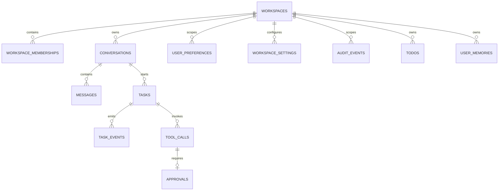

# MaigoKite 数据库设计

> 本文说明当前业务表、数据归属和事务边界，尚未实现的部分另行标注。
> 数据库升级与恢复的测试范围见 [路线图](../project/Roadmap.md#当前验收状态)。

建表和旧库增量升级 SQL 见 `python/agent/sqlite_schema.py`，业务查询和事务见 `python/agent/repository.py`；本文不把目标表写成已经存在的迁移。

## 1. 当前存储边界

- 当前业务数据库只有 SQLite，启用 foreign keys 与 WAL。
- SQLite 保存工作区、成员关系、会话、消息、任务、事件、工具调用、审批、设置、审计、Todo 和显式用户记忆。
- 模型与其他非敏感工作区配置保存在 `workspace_settings` JSON 中。
- 图片生成配置使用 `models.image_generation` 设置键，生图密钥仅存操作系统凭证库。消息表的 `attachments_json TEXT NOT NULL DEFAULT '[]'` 保存图片、文本和文档的文件夹、路径、哈希、类型及大小；扩展引用类型不新增资产表。分岔复制引用，不复制文件。LangGraph checkpoint 保存本轮组装的模型输入，普通消息/事件不保存 Base64。删除对话不删除 `chat-images/`、`chat-files/` 或 `generated-images/` 中的文件。旧图片引用、分岔和重启续聊已有定向记录；后续文本/文档/OCR 与旧库升级尚未行为验收，不能沿用图片结果宣布通过。
- 敏感凭证值由 Python API 通过操作系统凭证存储保存，不进入 SQLite；访问边界见 [后端设计](BackendDesign.md#3-凭证与访问边界)。
- 原始文档、FTS、向量嵌入、向量索引、PostgreSQL 和对象存储尚未接入。

当前 Repository 采用单进程写入模型。不能仅凭接口抽象，就推断它已支持多实例并发或 PostgreSQL。

天线扩展在服务 `--root` 中另存 `.antenna-project.sqlite3`，不属于下方主应用业务表。`project / reservations / budget_changes` 保存项目身份、求解准入、补画来源与限额调整，`workflows` 保存带 revision 和证据身份的有限设计里程碑。预算先提交再启动计算，失败/取消不自动退回；里程碑记录不表示 worker 活跃或支持自动续跑。已发布包与 SQLite 不具备共同事务，查询/取回可在核验证据后幂等补记交付状态，不重新求解。该库不与聊天 checkpoint 双向同步；恢复需保留项目库和服务产物，见 [备份与恢复](../ops-security/Backup.md)。

`sqlite_schema.py` 使用 Repository 创建的连接，不自行 commit、close 或持有锁。Repository 负责连接、锁和提交；审批决定、授权复用、任务与审计更新不拆成独立 Store。

会话级子 Agent 存储增量（新库设置/调用已验收，旧库迁移/子图恢复未覆盖）：启动迁移为 conversations 增加
`max_subagent_calls DEFAULT 0`、`max_concurrent_subagents DEFAULT 1`、`subagent_model_ids_json DEFAULT '[]'`；新任务准入事务复制三项设置到 tasks，
并记录 `model_call_limit / model_calls_used`。`tool_calls.subagent_admitted` 保存不可退还的派发准入收据；
计数与占位在 Repository 锁/事务中完成，同一调用 ID 的恢复不会重领派发额度。配置更新与准入共用锁，
活动任务的预算不跟随会话设置改变。旧任务默认为不启用委派；缺少预算快照时沿用原生模型调用限制。
这些是产品额度，不保存子 Agent 执行状态；LangGraph checkpoint 仍为唯一执行事实来源。
模型 ID 清单保存允许显式指定的配置项引用，不保存密钥/URL，不锁定配置内容版本；空列表表示仅跟随父模型。模型名称和实际路由身份在子 Agent 活动事件中记录。清单更新只影响后续任务；旧库启动迁移为两个表增列，不丢弃既有历史。新库设置/指定模型派发已定向验收，旧库增列和子图跨进程恢复仍未覆盖。

## 2. 当前归属模型

自动标题增量：`conversations.title_source` 只接受 `pending / automatic / manual`。既有库增列默认 `manual`，保留所有历史标题，不根据“新对话”等展示文字推断来源。新建未命名会话显式写入 `pending`；首条用户消息的准入事务同时更新标题与来源，重复提交不重新生成。显式改名和分岔使用 `manual`，不再按标题字面值判断。该升级不改变消息、审批或 checkpoint。

会话分岔增量：`conversations` 增加 `forked_from_conversation_id / forked_from_message_id / fork_request_hash`，默认空值，保留原数据。前两项为来源标记而非级联外键，源删除不影响分岔；请求指纹只用于创建幂等，不是执行续接状态。分岔与新 ID 的可见消息在同一 SQLite 事务中写入，不复制任务、审批或 checkpoint。新库 API 的消息复制/独立 ID/无旧任务及图片引用复制已通过；旧库迁移与幂等并发不在该通过范围。

- `workspaces.kind` 保留 `personal / team` 兼容值，当前产品只推进个人使用，不继续建设团队管理。
- 启动时创建 `personal` 工作区和 `local-user` 所有者成员关系。
- 会话、偏好、设置、审计、Todo 和用户记忆都显式带工作区归属。
- 任务、工具调用、审批与任务事件同时保存工作区、会话和任务关联，用于 API 作用域检查与恢复。
- 当前没有独立 `users` 表、Team 管理 API、邀请或完整身份生命周期；团队身份生命周期不在当前个人产品范围内。

## 3. 当前表

| 表 | 当前语义与关键字段 |
|---|---|
| `workspaces` | `id / name / kind / created_at / updated_at` |
| `workspace_memberships` | `(workspace_id, user_id)` 主键与 `role`；当前主要用于访问检查 |
| `workspace_folders` | 工作区下登记的 `name / root_path`；同工作区根路径唯一，删除登记不删除磁盘目录 |
| `conversations` | 工作区、`folder_id`、标题及 `title_source`、`model_id`、权限模式、思考/记忆/子 Agent 设置、分岔来源和时间；旧响应档位字段仍保留 |
| `messages` | 会话、`role / content / attachments_json / created_at`；没有显式 sequence/词元列 |
| `user_preferences` | `(workspace_id, subject_user_id, key)` 唯一，保存非敏感 JSON |
| `workspace_settings` | `(workspace_id, key)` 唯一，保存非敏感 JSON |
| `tasks` | 工作区/会话、输入、状态、最后错误、版本、时间、可选提交指纹 `request_hash`，以及本次输出契约 `output_schema_json` 与已校验结果 `output_result_json` |
| `task_events` | 任务/会话、会话内 sequence、类型、payload 和发生时间 |
| `tool_calls` | 任务、工具名、参数、结果、摘要、风险和状态；旧续接列只保留历史兼容 |
| `approvals` | 任务/工具调用、principal、参数摘要值、风险、版本、过期和决定时间；`reuse_scope_json / authorization_scope / authorization_expires_at / authorization_revoked_at` 保存有限期窄授权 |
| `audit_events` | 工作区、actor、action、resource、result、脱敏详情和时间 |
| `todos` | 工作区内的文本、完成状态和时间 |
| `questions` | 任务/工具调用、提问主体、标题、`options_json`、状态、版本与回答；工具调用 ID 唯一，等待回答不等于权限授权 |
| `task_inputs` | 任务内逐步插话的内容、状态、时间与幂等键；`(task_id, idempotency_key)` 唯一 |
| `user_memories` | 工作区 + subject user + `folder_scope`、类别、内容、来源、置信度和时间；旧记录归属为 NULL，不自动归入默认目录 |

安全确认复用 `questions`，不增加审批表或新的执行状态。新选项在 `options_json` 中保存稳定 `value` 和可读 `label`；回答保存 `safety.continue / safety.stop`，可见历史保存标签。旧无标识记录只按原确切回答兼容读取，不改写原 checkpoint。

User Preference 与用户记忆不合并：前者是显式产品设置，后者是用户可管理的长期信息。用户记忆支持手动 CRUD 和关键词查询；文件夹与对话开关同时开启时，手工条目可在预算内附带到当前模型请求，不写入消息或 checkpoint。双开关、遗忘和 checkpoint 分离已通过定向验收；自动提取和向量嵌入检索未实现。选择与隔离规则见 [记忆与检索边界](../agent-capabilities/memory/memory-system.md)，剩余门禁见 [当前验收状态](../project/Roadmap.md#当前验收状态)。

2026-10-11 权限升级使用原 SQLite 增列逻辑，历史审批默认 `once`、空复用范围/期限，不生成授权。复用信息仍是审批审计回执，不新增 Grant 表、Runtime 状态表或执行续接数据。旧会话权限 `full_access / auto` 规范化为 `workspace_auto`；新的 `danger_full_access` 不由旧值推导。迁移不删除业务数据。运行验收未在本批执行。

2026-10-16 新增显式 `authorization_scope=session_public_web`，复用上述 TEXT 字段，无表结构迁移、不改写旧回执。`reuse_scope_json` 保留原操作及策略边界；只有新 scope 才按内置搜索/公共网页读取组匹配，旧 `session` 仍按原范围精确匹配。该范围与 `session` 一样跨本会话任务复用，按原期限/撤销字段过滤；批准范围与原参数 hash 一起进入现有审计事务。

### 当前关系（逻辑归属与外键区别）



图中任务到工作区/会话是逻辑归属，并非已建立全部数据库外键。运行上下文从消息派生，不再复制一份消息表。

个人扩展配置复用 `workspace_settings`，不新增插件表：

- `extensions.config`：用户保存的期望配置，含 revision、MCP 程序/参数/凭证变量名、Skill 目录和托管 Markdown/启停选择；保存不代表已加载。
- `extensions.applied_config`：执行入口准备成功后保存的生效配置，Core 重启与恢复原连接以它为准，不误用尚未应用的编辑。它不是执行状态或工具执行记录，实际恢复仍读取 LangGraph checkpoint；外部程序/目录内容也不因此成为不可变快照。

原始凭证仅在系统密钥链；加载状态留在 Core 资源状态中，不落凭证值、生命周期日志或第二份执行状态。首次无数据库配置时读取 YAML 建立初始值；没有期望配置行时以生效配置作为编辑基线。升级前没有生效快照时沿用当时保存配置/YAML，不能追溯重建历史生效版本。

新路径的 LangGraph 检查点是独立执行存储，不添加到此业务 ER 图；恢复和业务投影边界见 [智能体运行时设计](AgentRuntime.md)。continuation_json 列仅保留历史数据库兼容；生产已删除该字段的续接读写代码，新的调用采用数据库默认空值，不破坏性删列。

## 4. 当前状态值

### 任务

```text
created, queued, running, waiting_approval, retry_wait,
succeeded, failed, rejected, expired, cancelled, timed_out, interrupted
```

当前运行路径主要使用 `running / waiting_approval / succeeded / failed / cancelled / timed_out / interrupted`；其余值为调度与重试预留。

### 工具调用

```text
proposed, waiting_approval, running, succeeded, failed,
denied, cancelled, timed_out, expired
```

### 审批

```text
pending, consumed, rejected, expired
```

状态字符串由应用层校验，当前 Schema 尚无数据库 `CHECK` 约束。任务与审批的版本递增。处理审批决定时，会校验 principal、版本、过期时间和当前参数摘要值。

## 5. 当前约束与索引

- `workspace_memberships(workspace_id, user_id)` 主键。
- `task_events(conversation_id, sequence)` 唯一，并按 sequence 查询。
- 一个工具调用通过 `approvals.tool_call_id UNIQUE` 最多关联一个审批。
- 工作区会话、任务、审计、Todo 和用户记忆有面向当前查询的索引。
- Messages 当前按 `created_at` 查询；同一时间戳的严格稳定排序仍需显式 sequence。
- Tasks 当前没有到工作区/会话的数据库外键，归属完整性依赖应用层；这是迁移债务。
- `task_events` sequence 通过当前单进程 SQLite 锁内的 `MAX + 1` 生成；多实例前必须改为数据库安全分配。

## 6. 当前事务边界与架构债务

`inspect_task()` / `conversation_snapshot()` 的全部查询和游标读取仍在 Repository 的同一锁内完成；之后将已读取的行交给 `inspector/snapshots.py` 纯函数组装展示结果。该模块不接收数据库连接，也不执行 SQL；事件顺序、记录数量、返回大小和 `truncated` 标记沿用原规则，不调用预留 Timeline。审批记录的 JSON 解码复用同一个转换函数，审批决定与审计写入仍在 Repository。

当前在单个 SQLite 事务中完成：

- 创建审批，并把工具调用/任务切换为等待；
- 决定、过期或取消审批，并同步更新关联工具调用/任务；
- 单次 Repository 方法内部的数据修改。
- 结构化任务的最终结果、对应助手消息、会话更新时间和 succeeded 状态由 `complete_structured_task` 同事务提交；终态不被再次覆盖。只有成功且存在结果的记录可供后续步骤消费。它是产品交付物，不替代 LangGraph execution checkpoint。
- 聊天准入时检查归属/归档/未结束任务，创建任务与用户消息并更新会话时间；单一 LangGraph 路径使用 `start_chat_turn`。带幂等键的 task ID 按工作区/会话/主体/键派生，`request_hash` 校验 content/attachments。重发返回原任务，不触发模型或副作用；不额外创建通用幂等请求库。

尚未原子完成：

- 已原子创建的用户消息/任务与首个任务事件之间；
- 任务状态转换与对应任务事件；
- 工具调用结果、任务推进与事件发布。

`EventBus` 当前先写 `task_events`，再实时投递事件，因此断线后可以回放。但领域状态与事件的写入不在同一事务中。尚无正式 Unit of Work/Outbox。应先修复需要原子提交的最小事务，不预设必须建设完整事件溯源或通用 Outbox 框架。

会话 snapshot 在单 Core Repository 锁内读取各产品列表与事件水位，最大行数和响应预算见 API。它不承诺多个 Core 共用数据库的一致性，不从产品记录重建 LangGraph checkpoint。任务 inspection 的用量为事件只读聚合，没有第二份持久 token 账本。新增 `request_hash` 使用既有受限 ALTER 迁移，旧任务默认空指纹；不会把旧任务猜测为某次新提交的重放。

结构化输出使用既有增列迁移：`tasks.output_schema_json TEXT NOT NULL DEFAULT ''`、`tasks.output_result_json TEXT`。旧任务保持普通聊天/无结构化结果，不从旧助手文本推导 JSON。输出契约在任务准入时固定，幂等指纹在结构化请求中增加 Schema，普通请求指纹不改变。结果列保留标准 JSON 文本（不是 pickle），受大小与深度限制；不新增工作流状态表。具体契约见 [API 结构化任务结果](API.md#结构化任务结果)。本次仅源码修改与人工审阅，未打开或迁移用户实际数据库。

## 7. 当前迁移方式

- Repository 启动时执行 `CREATE TABLE IF NOT EXISTS`，并用受限 `ALTER TABLE ADD COLUMN` 兼容旧库。
- 当前没有独立、有版本号的迁移工具，也没有自动 rollback。
- 修改表结构必须至少验证空库启动和现存 SQLite 文件升级。
- 活动数据库备份应使用 SQLite backup API 或一致性快照，不能直接复制正在写入的文件。

## 8. 演进约束

未来只在需求、API、迁移与测试一起交付时增加数据结构，不预建工作流/Schedule/技能分发等整套目标表。完整 Team 身份、PostgreSQL 和多实例部署不进入当前个人路线。

- 先补当前需要的排序、归属与原子提交约束，再评估是否需要成熟迁移工具；不把 ORM/迁移框架当本轮前置条件。
- 文档检索若落地，原文是权威，数据片段/FTS/vector 是可删除重建的索引；删除原文须同步清理或登记清理索引。
- 运行恢复复用运行时检查点；不要另建 task_runs/lease/续接数据体系来复制执行事实。
- 全部业务数据直接或间接绑定工作区；UTC 时间、ID、状态与授权语义不能因换存储改变。
- 敏感凭证不进入业务库、记忆、任务事件或普通日志；新增配置只存非敏感值/引用。
- 备份和恢复须覆盖业务库、所用检查点和用户文件的适用边界，见 [备份与恢复](../ops-security/Backup.md)。

### 附件快照（2026-10-28）

消息继续使用 `attachments_json`，数组兼容原 `ImageReference`，增加带原文件显示名的 `TextReference` 和带格式信息的 `DocumentReference`（PDF/DOCX/XLSX/PPTX）；不新增资产数据库或执行状态表。附件的身份是工作区文件夹、相对路径和 SHA-256，工作区文件引用会先复制到应用生成的快照路径。修改源文件不会改写旧消息；修改快照本身则在预览、请求准入或 `file_read` 哈希校验时拒绝。

产品消息只保存引用，预算内联内容由现有 LangGraph 消息状态保留。首次输入使用现有 before_model hook 物化并更新该消息；后续追加消息不重复展开。摘要保留已归档附件的确定性引用，恢复仍以 checkpoint 为准。删除会话不删除附件文件，附件清理由用户在工作区文件管理中完成。

文档目录与关键词定位是原始快照的派生读取结果，仅使用有限进程内解析缓存；不新增目录表、向量索引或跨会话检索状态。目录/搜索 API 返回哈希和 parser_version，模型工具结果沿用既有 checkpoint 与压缩引用。

附件授权约束不新增表：Repository 从当前会话同文件夹的用户消息 `attachments_json` 读取去重的 path/sha256 集合并排序计算摘要；`approvals.reuse_scope_json` 中的 `attachment_sources` 绑定该集合。新附件或新版本不能复用旧授权，重启后仍从消息推导；分岔仅继承已复制的消息。未知/高风险操作只允许单次批准，集合摘要不扩大原目录/命令/站点范围。原始文件快照、LangGraph checkpoint 与审批审计仍各司其职。
