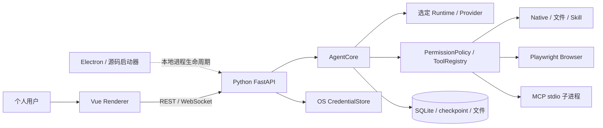

# 系统设计

> 本文说明个人智能体的系统边界、组件所有权与运行形态；字段、状态机和配置在各专项文档中维护。

## 1. 产品范围与原则

MaigoKite 是本地优先、用户可控的个人通用智能体，为用户选定的工作流提供定制能力，不建设通用智能体平台、团队 SaaS 或编码专用产品。产品范围见 [产品愿景](../project/Vision.md)，验收见 [需求与验收](../requirements/RequirementList.md)。

- 副作用由用户权限模式与审批控制，模型不能自授权。
- 每个进程、运行状态和共享资源只有一个明确所有者。
- 优先复用成熟的运行时、模型提供方、MCP、浏览器、取消与持久执行组件；没有明确收益时不自研替代。
- 默认本地数据；云模型、联网与未来远程访问显式启用。
- 机器契约和实际代码优先，Markdown 不维护另一套结构定义。

## 2. 组件与依赖方向

| 组件 | 职责 |
| --- | --- |
| Vue | 对话、设置、文件、活动检查与审批交互 |
| Electron | 安全窗口、白名单 IPC、桌面子进程启动和关闭 |
| Python API | REST/WS、本机来源与工作区归属、输入限额、凭证边界 |
| Python 核心服务 | 产品命令、策略、工具/模型提供方资源、业务持久化与事件投影 |
| 成熟运行时 | 模型循环、工具编排、HITL 与检查点 |

执行统一为 LangChain create_agent + LangGraph，现有工具通过公开转换接入。执行范围与状态所有权见 [智能体运行时设计](AgentRuntime.md)。

领域工作流作为可选扩展接入，不改变通用执行链。当前天线计算包位于 `extensions/antenna_design/`，可独立使用，也可通过 MCP 接入；宿主仅校验和导入结果，不依赖其求解器类型或数值库。架构与实现范围见 [天线工作流](AntennaWorkflow.md)。

## 3. 工作区与数据

工作区是个人项目、文件和资料边界。`personal/team` 数据值与成员关系表仅为兼容保留；当前没有 User/Team 管理 API。手机与桌面访问同一用户数据，未来配对设备身份与业务成员关系分开。

SQLite 是当前唯一业务库，领域写入由 Python Repository 管理。敏感凭证值在 OS 凭证存储，受控同步到核心服务内存，不进入普通配置。模型执行检查点由 LangGraph checkpointer 单独保存，只服务执行续接；产品数据以 Repository 为准，两者不双向同步。

消息和原始材料是事实来源；摘要、搜索结果与未来索引由它们派生。手工记忆可在文件夹和对话开关同时开启时附带到模型请求，但不会自动从聊天中提取信息，也没有语义检索。向量嵌入和索引仍未接入，数据约束见 [数据库设计](Database.md)。

## 4. 通信与信任边界

| 边界 | 当前协议 / 契约 |
| --- | --- |
| UI ↔ Python API | HTTP/WebSocket；[API 设计](API.md)、FastAPI OpenAPI 与产品事件 DTO |
| API → 核心服务 | 同一进程内调用 AgentCore / Repository，无跨语言 RPC |
| 核心服务 ↔ MCP | 当前 stdio；[MCP](../agent-capabilities/mcp/mcp-integration.md) |
| 核心服务 → 模型提供方 | 复用模型提供方库；[模型接入](../agent-capabilities/models/model-routing.md) |
| 核心服务 → 存储 | Repository / LangGraph checkpointer，分别管理业务与执行状态 |

请求必须依次经过本机来源/工作区归属检查、Python ToolPolicy、实际资源边界与 hard-deny。API 允许不能跳过工具策略，技能也不能扩大授权。风险与模式的唯一矩阵见 [工具权限](../agent-capabilities/security/tool-permission.md)。

桌面请求还需通过 Electron 每次启动生成的凭据验证；仅来自 loopback 或声明 `Origin: null` 不足以获得访问权。浏览器模式与受管桌面模式的具体区别见 [后端访问边界](BackendDesign.md#3-凭证与访问边界)，该凭据不提供手机远程认证。

## 5. 本地运行与关闭

桌面模式为 Electron + 单 Python 后端，默认只监听 127.0.0.1:8080；Web 构建版由同一后端提供静态页面，开发版另外启动 Vite。MCP 子进程由核心服务持有。源码启动器和 Electron 协调退出，核心服务等待活动运行实例清理后关闭依赖；先清理后台执行，再标记 cancelled。CLI 可指定 loopback 端口，成套入口与前端代理约定使用 8080。

本地 loopback/Origin 边界不提供设备认证。安装包与 runtime bundling 尚未完成，见 [构建与发布指南](../deployment/ReleaseGuide.md)。

多人服务器、PostgreSQL、Kubernetes 和分布式 Worker 不在路线内；Docker/服务器部署的边界见 [构建与发布指南](../deployment/ReleaseGuide.md)。

## 6. 恢复与未来远程访问

WebSocket 只传递事件；UI 读取持久事件并去重，连接中断不自动取消主机任务。执行恢复以 LangGraph 检查点为依据，缺少检查点的历史任务不能续跑；浏览器 session 是易失资源，重启后不能续跑。恢复资格与限制见 [智能体运行时设计](AgentRuntime.md) 和 [API 设计](API.md)。

手机 Web/PWA 为规划中，通过受保护 HTTPS 入口访问同一 Python API，复用电脑上的运行时；反向代理落到 loopback 也要认证。当前没有设备配对认证，不要直接公开本地端口。连接方案、权限和 R0–R3 验收见 [手机远程访问](RemoteAccess.md)。

## 7. 专项入口

- [后端设计](BackendDesign.md)、[前端与桌面交互设计](FrontendDesign.md)
- [API 设计](API.md)、[数据库设计](Database.md)、[智能体运行时设计](AgentRuntime.md)
- [安全边界](../ops-security/Security.md)、[工具权限](../agent-capabilities/security/tool-permission.md)
- [交付路线与状态](../project/Roadmap.md)、[架构决策](../reference/Decisions.md)

## 8. 已知限制

- 子 Agent 只支持单层只读委派；持久工作流、后台/可写子 Agent 和远程 MCP 尚未实现。
- 安装包与 runtime bundling 尚未完成，目前需从源码启动。
- 手机远程访问仍在规划，没有设备配对认证。
